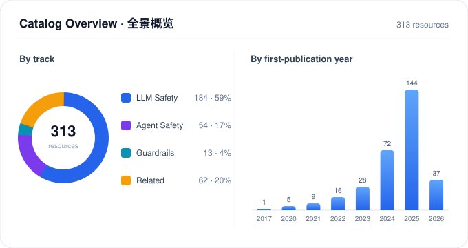

<h1>🛡️ Awesome LLM &amp; Agent Safety Benchmarks</h1>

<h3>大模型与智能体安全评测目录 · 基准 / 数据集 / 工具</h3>

A maintained, bilingual catalog of LLM &amp; agent safety evaluation — benchmarks, datasets and tools, each traced to its paper, code or data.

313 resources · 4 tracks · 25 topics · 437 links verified

> **Scope · 收录范围：** Evaluation benchmarks, datasets and tools for LLM / agent safety — jailbreaks, prompt injection, privacy, guardrails, bias, values and agent misuse. Training corpora, attack toolkits and capability baselines appear only as *context* under Related Resources, not as core safety evaluations.
>
> **收录范围：** 面向大模型 / 智能体安全的评测基准、数据集与工具——涵盖越狱、提示注入、隐私、护栏、偏见、价值观与 Agent 滥用。训练语料、攻击工具与能力基线仅作为「背景」列在 Related Resources，不算核心安全评测。

Last updated 2026-11-01 · maintained weekly · <a href="CONTRIBUTING.md">suggest a resource or correction</a>

## Start here | 从这里开始

| 你想做什么 · What you want | 从这里开始 · Start here | 下结论前先确认 · Check before concluding |
| --- | --- | --- |
| 评估模型抗越狱 / 提示注入 | LLM Safety → Jailbreaks / Prompt injection | 评分器是否验证过、有无数据污染 |
| 给 Agent 做红队 / 安全评测 | Agent Safety → Tool/MCP, Trajectories | 工具权限、良性效用、重复试验次数 |
| 选 / 对比一个护栏或安全评判器 | Guardrails & Judging | 在什么数据分布上测的、误拦率多少 |
| 找训练数据 / 攻击方法做对照 | Related Resources | 仅作背景，不算核心安全评测 |

状态图例 · Status: Listed = 核心安全评测 · Related = 背景资料 · Needs review = 待核验

## Explore | 快速浏览

<table width="100%">
<tr>
<td width="50%" valign="top"><a href="#llm_safety"><strong>🧩 LLM Safety</strong></a> LLM 安全 · 184 resources  How models hold up under harm, jailbreak, bias, privacy and alignment pressure — full suites and targeted probes. 模型在有害内容、越狱、偏见、隐私与对齐压力下的表现——综合套件与针对性探针。</td>
<td width="50%" valign="top"><a href="#agent_safety"><strong>🤖 Agent Safety</strong></a> Agent 安全 · 54 resources  Where agents break: tool / MCP calls, memory, web & desktop use, and misuse scenarios. Agent 在何处失守：工具 / MCP 调用、记忆、网页与桌面操作，以及滥用场景。</td>
</tr>
<tr>
<td width="50%" valign="top"><a href="#safety_judging"><strong>⚖️ Guardrails & Judging</strong></a> 安全审查与护栏 · 13 resources  Judging and filtering: trajectory-level safety, content moderation, and safety classifiers. 判定与过滤：轨迹级安全、内容审核与安全分类器。</td>
<td width="50%" valign="top"><a href="#related_resources"><strong>🧰 Related Resources</strong></a> 相关资源 · 62 resources  The surrounding toolkit: training data, attack methods, environments, and diagnostics. 周边工具链：训练数据、攻击方法、评测环境与诊断资源。</td>
</tr>
</table>

<strong>By risk area · 按风险领域直达</strong>

<a href="#llm_safety-jailbreak">🧨 Jailbreaks · 越狱</a> · <a href="#llm_safety-prompt_injection">🧱 Prompt injection · 提示注入</a> · <a href="#llm_safety-privacy">🔒 Privacy · 隐私</a> · <a href="#agent_safety-tool_mcp">🛠️ Tools/MCP · 工具/MCP</a> · <a href="#safety_judging-agent_trajectory">🧭 Trajectories · 轨迹</a> · <a href="#safety_judging-content_guardrail">🛡️ Guardrails · 护栏</a>

<a href="data/benchmarks.csv">Download CSV · 下载目录</a> · <a href="docs/taxonomy.md">Taxonomy · 分类说明</a> · <a href="CONTRIBUTING.md">Contribute · 参与共建</a>

<strong>Table of contents · 目录</strong>

| Track | Topics |
| --- | --- |
| **[LLM Safety](#llm_safety)** | [Comprehensive safety](#llm_safety-comprehensive) 23 · [Harmful content and toxicity](#llm_safety-harmful_content) 54 · [Jailbreaks and adversarial prompts](#llm_safety-jailbreak) 38 · [Prompt injection and instruction boundaries](#llm_safety-prompt_injection) 10 · [Bias and fairness](#llm_safety-bias_fairness) 18 · [Values, ethics and cultural norms](#llm_safety-values_ethics) 13 · [Privacy](#llm_safety-privacy) 8 · [Over-refusal](#llm_safety-overrefusal) 8 · [Autonomy and alignment](#llm_safety-autonomy_alignment) 6 · [Domain risks](#llm_safety-domain_risk) 6 |
| **[Agent Safety & Security](#agent_safety)** | [Prompt injection and instruction boundaries](#agent_safety-prompt_injection) 10 · [General agent safety and misuse](#agent_safety-general) 19 · [Tool, API and MCP safety](#agent_safety-tool_mcp) 10 · [Privacy and memory](#agent_safety-privacy_memory) 4 · [Web, computer and mobile agents](#agent_safety-web_computer_mobile) 10 · [Embodied safety](#agent_safety-embodied) 1 |
| **[Safety Judging & Guardrails](#safety_judging)** | [Agent trajectories and action safety](#safety_judging-agent_trajectory) 9 · [Content guardrail evaluation](#safety_judging-content_guardrail) 4 |
| **[Related Resources](#related_resources)** | [Training datasets](#related_resources-training_data) 12 · [Attack methods](#related_resources-attack_methods) 15 · [Frameworks and mixed resources](#related_resources-frameworks) 7 · [Attack challenges and data](#related_resources-attack_data) 1 · [Capability baselines and environments](#related_resources-capability_environments) 11 · [Factuality and general trace diagnostics](#related_resources-reliability) 5 · [Domain capability benchmarks](#related_resources-domain_capability) 9 · [Components of listed suites](#related_resources-suite_components) 2 |

## Taxonomy & Evidence | 分类与依据

> Resources are filed along **4 tracks and 25 topics**, with a separate risk-taxonomy proposal still under review. The links below explain the structure, the rationale, and how each entry maps back to its source.
>
> 资源按 **4 个主轨、25 个主题** 归类，并附一套仍在评审中的风险分类提案。下列链接说明分类结构、设计依据，以及每条资源如何回溯到来源。

| 🧭 Understand the catalog | 🔎 Examine the design | 📚 Trace the evidence |
| --- | --- | --- |
| [**分类总览 · Overview**](docs/taxonomy.md) 评测主轨与资源实例 | [**设计依据 · Rationale**](docs/taxonomy-rationale.md) 多轴结构的依据与分类边界 | [**来源与映射 · Sources**](docs/taxonomy-research-2026-10-16.md#source-matrix) 标准、研究框架与版本范围 |

[Candidate taxonomy · 候选分类](docs/taxonomy-proposal.md) · [Validation roadmap · 验证计划](docs/taxonomy-validation.md) · [JSON definition · 机器定义](docs/taxonomy-proposal-v0.1.json)

> **Proposal status · 提案状态：** The 12-domain / 39-subtype risk taxonomy is a proposal under review — the catalog itself is still organized by track and topic, not by that taxonomy yet. Counts and boundaries will be adjusted as validation proceeds.
>
> 当前 12 域 / 39 子类的风险分类是一份待验证提案——目录目前仍按主轨与主题组织，尚未套用该分类。类别数量与边界将随验证推进调整。

## Catalog | 目录

<table width="100%">
<thead>
<tr><th width="18%">Resource</th><th width="46%">Description</th><th width="10%">Year</th><th width="10%">Language</th><th width="16%">Links</th></tr>
</thead>
<tbody>
<tr><th colspan="5" align="left" id="llm_safety"><strong>1. LLM Safety | LLM 安全</strong></th></tr>
<tr><td colspan="5" align="left" id="llm_safety-comprehensive"><strong>1.1 Comprehensive safety | 综合安全</strong></td></tr>
<tr><td width="18%">AILuminate</td><td width="46%">Safety prompts for chat systems across hazard categories | 跨风险类别的对话系统安全提示评测</td><td width="10%">2025</td><td width="10%">zh, en, other</td><td width="16%"><a href="https://github.com/mlcommons/ailuminate">Code</a></td></tr>
<tr><td width="18%">Audio&#8203;Trust</td><td width="46%">AudioTrust: Benchmarking the Multifaceted Trustworthiness of Audio Large Language Models (arXiv:2505.16211, 2025). Scope: Audio LLMs Trustworthiness Evaluation Multimodal Safety. | AudioTrust: Benchmarking the Multifaceted Trustworthiness of Audio Large Language Models（2025年发布，arXiv:2505.16211）。研究范围：Audio LLMs Trustworthiness Evaluation Multimodal Safety。</td><td width="10%">2025</td><td width="10%">en</td><td width="16%"><a href="https://arxiv.org/abs/2505.16211">Paper</a></td></tr>
<tr><td width="18%">Ch3Ef</td><td width="46%">Evaluates helpfulness, honesty, and harmlessness across 12 domains and 46 tasks. | HHH（helpful/honest/harmless）对齐12域46任务</td><td width="10%">2024</td><td width="10%">en</td><td width="16%"><a href="https://arxiv.org/abs/2403.17830">Paper</a></td></tr>
<tr><td width="18%">CHi&#8203;Safety&#8203;Bench</td><td width="46%">Tests recognition of safety risks and refusal behavior. | 风险识别与拒绝</td><td width="10%">2024</td><td width="10%">zh</td><td width="16%"><a href="https://github.com/UnicomAI/UnicomBenchmark/tree/main/CHiSafetyBench">Code</a></td></tr>
<tr><td width="18%">Decoding&#8203;Trust</td><td width="46%">Checks for training-data leakage in language models. | 训练数据泄露</td><td width="10%">2024</td><td width="10%">en</td><td width="16%"><a href="https://huggingface.co/datasets/AI-Secure/DecodingTrust">Data</a></td></tr>
<tr><td width="18%">ELBA-&#8203;Bench</td><td width="46%">ELBA-Bench: An Efficient Learning Backdoor Attacks Benchmark for Large Language Models (arXiv:2502.18511, 2025). Scope: Backdoor Attacks LLM Security Benchmarking. | ELBA-Bench: An Efficient Learning Backdoor Attacks Benchmark for Large Language Models（2025年发布，arXiv:2502.18511）。研究范围：Backdoor Attacks LLM Security Benchmarking。</td><td width="10%">2025</td><td width="10%">en</td><td width="16%"><a href="https://arxiv.org/abs/2502.18511">Paper</a></td></tr>
<tr><td width="18%">Flames</td><td width="46%">Chinese value-alignment evaluation spanning safety, fairness, morality, privacy, and legality. | 中文价值对齐（安全、公平、道德、数据保护、合法性）</td><td width="10%">2023</td><td width="10%">zh</td><td width="16%"><a href="https://github.com/AI45Lab/Flames">Code</a></td></tr>
<tr><td width="18%">Foresight&#8203;Safety Bench</td><td width="46%">LLM safety evaluation across content, deception, embodied and existential risks | 覆盖内容安全、欺骗、具身与存在风险的综合安全评测</td><td width="10%">2026</td><td width="10%">en</td><td width="16%"><a href="https://github.com/Beijing-AISI/ForesightSafety-Bench">Code</a></td></tr>
<tr><td width="18%">Jail&#8203;Bench</td><td width="46%">Chinese multi-domain jailbreak risk evaluation data | 中文多领域越狱攻击风险评测数据</td><td width="10%">2025</td><td width="10%">zh</td><td width="16%"><a href="https://github.com/STAIR-BUPT/JailBench">Code</a></td></tr>
<tr><td width="18%">Long&#8203;Safety</td><td width="46%">Long-context, open-ended tasks testing model safety. | 长上下文开放任务安全</td><td width="10%">2025</td><td width="10%">en</td><td width="16%"><a href="https://github.com/thu-coai/LongSafety">Code</a></td></tr>
<tr><td width="18%">MMDT (Multimodal Decoding&#8203;Trust)</td><td width="46%">Unified platform for comprehensive trustworthiness and safety evaluation of multimodal foundation models across safety, fairness, privacy, and robustness. | 面向多模态基础模型的可信与安全综合评测平台，覆盖安全、公平、隐私与鲁棒性。</td><td width="10%">2025</td><td width="10%">en</td><td width="16%"><a href="https://arxiv.org/abs/2503.14827">Paper</a></td></tr>
<tr><td width="18%">MSTS</td><td width="46%">MSTS: A Multimodal Safety Test Suite for Vision-Language Models (arXiv:2501.10057, 2025). Scope: Multimodal Safety Vision-Language Models. | MSTS: A Multimodal Safety Test Suite for Vision-Language Models（2025年发布，arXiv:2501.10057）。研究范围：Multimodal Safety Vision-Language Models。</td><td width="10%">2025</td><td width="10%">en</td><td width="16%"><a href="https://arxiv.org/abs/2501.10057">Paper</a></td></tr>
<tr><td width="18%">Real&#8203;Safe-&#8203;R1</td><td width="46%">RealSafe-R1: Safety-Aligned DeepSeek-R1 without Compromising Reasoning Capability (arXiv:2504.10081, 2025). Scope: Safety Alignment DeepSeek-R1 Large Reasoning Models. | RealSafe-R1: Safety-Aligned DeepSeek-R1 without Compromising Reasoning Capability（2025年发布，arXiv:2504.10081）。研究范围：Safety Alignment DeepSeek-R1 Large Reasoning Models。</td><td width="10%">2025</td><td width="10%">en</td><td width="16%"><a href="https://arxiv.org/abs/2504.10081">Paper</a></td></tr>
<tr><td width="18%">Safe&#8203;MT</td><td width="46%">SafeMT: Multi-turn Safety for Multimodal Language Models (arXiv:2510.12133, 2025). Scope: Multi-turn safety benchmark for multimodal LLMs (10K samples, 17 scenarios). | SafeMT: Multi-turn Safety for Multimodal Language Models（2025年发布，arXiv:2510.12133）。研究范围：Multi-turn safety benchmark for multimodal LLMs (10K samples, 17 scenarios)。</td><td width="10%">2025</td><td width="10%">en</td><td width="16%"><a href="https://arxiv.org/abs/2510.12133">Paper</a></td></tr>
<tr><td width="18%">Safety&#8203;Bench</td><td width="46%">Chinese-English multiple-choice evaluation across safety risk categories | 覆盖多类安全风险的中英双语选择题评测</td><td width="10%">2024</td><td width="10%">zh, en</td><td width="16%"><a href="https://github.com/thu-coai/SafetyBench">Code</a></td></tr>
<tr><td width="18%">SALAD-&#8203;Bench</td><td width="46%">Hierarchical safety evaluation with attack- and defense-enhanced examples | 含攻击增强与防御增强样本的分层安全评测</td><td width="10%">2024</td><td width="10%">en</td><td width="16%"><a href="https://adwardlee.github.io/salad_bench/">Project</a></td></tr>
<tr><td width="18%">Super&#8203;CLUE-&#8203;Safety</td><td width="46%">Multi-turn Chinese LLM safety across harms, responsibility and attacks | 中文大模型多轮对抗安全评测，覆盖传统安全、责任与指令攻击</td><td width="10%">2024</td><td width="10%">zh</td><td width="16%"><a href="https://www.cluebenchmarks.com/superclue_safety.html">Project</a></td></tr>
<tr><td width="18%">Think&#8203;In&#8203;Safety</td><td width="46%">Think in Safety: Unveiling and Mitigating Safety Alignment Collapse in Multimodal Large Reasoning Model (arXiv:2505.06538, 2025). Scope: Multimodal Large Reasoning Models Safety Alignment Chain-of-Thought. | Think in Safety: Unveiling and Mitigating Safety Alignment Collapse in Multimodal Large Reasoning Model（2025年发布，arXiv:2505.06538）。研究范围：Multimodal Large Reasoning Models Safety Alignment Chain-of-Thought。</td><td width="10%">2025</td><td width="10%">en</td><td width="16%"><a href="https://arxiv.org/abs/2505.06538">Paper</a></td></tr>
<tr><td width="18%">Trust&#8203;LLM</td><td width="46%">Evaluates trustworthiness across truthfulness, safety, fairness, robustness, privacy, and ethics. | 可信性六维综合评测（真实性/安全/公平/鲁棒/隐私/机器伦理）</td><td width="10%">2024</td><td width="10%">en</td><td width="16%"><a href="https://github.com/HowieHwong/TrustLLM">Code</a></td></tr>
<tr><td width="18%">U-&#8203;Safe&#8203;Bench</td><td width="46%">Evaluates model safety against user-specific standards. | 用户特定安全标准评测</td><td width="10%">2025</td><td width="10%">en</td><td width="16%"><a href="https://github.com/yeonjun-in/U-SafeBench">Code</a></td></tr>
<tr><td width="18%">USB</td><td width="46%">USB: A Comprehensive and Unified Safety Evaluation Benchmark for Multimodal Large Language Models (arXiv:2505.23793, 2025). Scope: Multimodal LLMs Safety Evaluation Benchmark. | USB: A Comprehensive and Unified Safety Evaluation Benchmark for Multimodal Large Language Models（2025年发布，arXiv:2505.23793）。研究范围：Multimodal LLMs Safety Evaluation Benchmark。</td><td width="10%">2025</td><td width="10%">en</td><td width="16%"><a href="https://arxiv.org/abs/2505.23793">Paper</a></td></tr>
<tr><td width="18%">Video&#8203;LLMSafety</td><td width="46%">From Evaluation to Defense: Advancing Safety in Video Large Language Models (arXiv:2505.16643, 2025). Scope: Video LLMs Safety Benchmark Multimodal Defense. | From Evaluation to Defense: Advancing Safety in Video Large Language Models（2025年发布，arXiv:2505.16643）。研究范围：Video LLMs Safety Benchmark Multimodal Defense。</td><td width="10%">2025</td><td width="10%">en</td><td width="16%"><a href="https://arxiv.org/abs/2505.16643">Paper</a></td></tr>
<tr><td width="18%">VLM-&#8203;Safety&#8203;Fine&#8203;Tuning</td><td width="46%">Rethinking Bottlenecks in Safety Fine-Tuning of Vision Language Models (arXiv:2501.18533, 2025). Scope: Vision-Language Models (VLMs) Chain-of-Thought (CoT). | Rethinking Bottlenecks in Safety Fine-Tuning of Vision Language Models（2025年发布，arXiv:2501.18533）。研究范围：Vision-Language Models (VLMs) Chain-of-Thought (CoT)。</td><td width="10%">2025</td><td width="10%">en</td><td width="16%"><a href="https://arxiv.org/abs/2501.18533">Paper</a></td></tr>
<tr><td colspan="5" align="left" id="llm_safety-harmful_content"><strong>1.2 Harmful content and toxicity | 有害内容与毒性</strong></td></tr>
<tr><td width="18%">Aegis2.0</td><td width="46%">Aegis2.0: A Diverse AI Safety Dataset and Risks Taxonomy for Alignment of LLM Guardrails (arXiv:2501.09004, 2025). Scope: AI Safety Content Moderation Dataset LLM Risk Taxonomy. | Aegis2.0: A Diverse AI Safety Dataset and Risks Taxonomy for Alignment of LLM Guardrails（2025年发布，arXiv:2501.09004）。研究范围：AI Safety Content Moderation Dataset LLM Risk Taxonomy。</td><td width="10%">2025</td><td width="10%">en</td><td width="16%"><a href="https://arxiv.org/abs/2501.09004">Paper</a></td></tr>
<tr><td width="18%">ai&#8203;Xamine</td><td width="46%">aiXamine: Simplified LLM Safety and Security (arXiv:2504.14985, 2025). Scope: LLM Safety Security Evaluation Black-box Benchmarking. | aiXamine: Simplified LLM Safety and Security（2025年发布，arXiv:2504.14985）。研究范围：LLM Safety Security Evaluation Black-box Benchmarking。</td><td width="10%">2025</td><td width="10%">en</td><td width="16%"><a href="https://arxiv.org/abs/2504.14985">Paper</a></td></tr>
<tr><td width="18%">ALKALI</td><td width="46%">AdversariaL attacK sAfety aLIgnment(ALKALI): Safeguarding LLMs through GRACE: Geometric Representation-Aware Contrastive Enhancement- Introducing Adversarial Vulnerability Quality Index (AVQI) (arXiv:2506.08885, 2025). Scope: LLM Safety Adversarial Benchmark Latent Camouflage Contrastive Alignment AVQI. | AdversariaL attacK sAfety aLIgnment(ALKALI): Safeguarding LLMs through GRACE: Geometric Representation-Aware Contrastive Enhancement- Introducing Adversarial Vulnerability Quality Index (AVQI)（2025年发布，arXiv:2506.08885）。研究范围：LLM Safety Adversarial Benchmark Latent Camouflage Contrastive Alignment AVQI。</td><td width="10%">2025</td><td width="10%">en</td><td width="16%"><a href="https://arxiv.org/abs/2506.08885">Paper</a></td></tr>
<tr><td width="18%">Answer&#8203;Carefully</td><td width="46%">AnswerCarefully: A Dataset for Improving the Safety of Japanese LLM Output (arXiv:2506.02372, 2025). Scope: LLM Safety Japanese Dataset Safety Fine-Tuning. | AnswerCarefully: A Dataset for Improving the Safety of Japanese LLM Output（2025年发布，arXiv:2506.02372）。研究范围：LLM Safety Japanese Dataset Safety Fine-Tuning。</td><td width="10%">2025</td><td width="10%">en, ja</td><td width="16%"><a href="https://arxiv.org/abs/2506.02372">Paper</a></td></tr>
<tr><td width="18%">ATLAS Challenge 2025</td><td width="46%">Adversarial testing grand challenge evaluating multimodal LLM jailbreak vulnerabilities via image-text attacks across white-box and black-box phases. | 对抗性安全评测大赛，通过图文攻击在白盒与黑盒阶段评测多模态大语言模型的越狱脆弱性。</td><td width="10%">2025</td><td width="10%">en</td><td width="16%"><a href="https://arxiv.org/abs/2506.12430">Paper</a> <a href="https://github.com/NY1024/ATLAS_Challenge_2025">Code</a></td></tr>
<tr><td width="18%">Auto&#8203;Adv&#8203;Ex&#8203;Bench</td><td width="46%">AutoAdvExBench: Benchmarking autonomous exploitation of adversarial example defenses (arXiv:2503.01811, 2025). Scope: Adversarial Example Defenses LLM Security Autonomous Exploitation. | AutoAdvExBench: Benchmarking autonomous exploitation of adversarial example defenses（2025年发布，arXiv:2503.01811）。研究范围：Adversarial Example Defenses LLM Security Autonomous Exploitation。</td><td width="10%">2025</td><td width="10%">en</td><td width="16%"><a href="https://arxiv.org/abs/2503.01811">Paper</a></td></tr>
<tr><td width="18%">Beaver&#8203;Tails</td><td width="46%">Safety classification, preference and response evaluation datasets | 有害内容分类、安全偏好与安全响应评测数据</td><td width="10%">2023</td><td width="10%">zh, en</td><td width="16%"><a href="https://sites.google.com/view/pku-beavertails">Project</a></td></tr>
<tr><td width="18%">Chinese&#8203;Harm-&#8203;Bench</td><td width="46%">ChineseHarm-Bench: A Chinese Harmful Content Detection Benchmark (arXiv:2506.10960, 2025). Scope: Harmful Content Detection Chinese Benchmark LLM Safety Knowledge Augmentation Content Moderation. | ChineseHarm-Bench: A Chinese Harmful Content Detection Benchmark（2025年发布，arXiv:2506.10960）。研究范围：Harmful Content Detection Chinese Benchmark LLM Safety Knowledge Augmentation Content Moderation。</td><td width="10%">2025</td><td width="10%">zh, en</td><td width="16%"><a href="https://arxiv.org/abs/2506.10960">Paper</a></td></tr>
<tr><td width="18%">Chinese&#8203;Safe</td><td width="46%">Chinese unsafe content spanning politics, pornography, violence, and homophone-based evasion. | 政治敏感/色情/暴恐/变体谐音规避（4大类10小类）</td><td width="10%">2024</td><td width="10%">zh</td><td width="16%"><a href="https://huggingface.co/datasets/SUSTech/ChineseSafe">Data</a></td></tr>
<tr><td width="18%">COLD</td><td width="46%">Offensive and harmful language risks in Chinese text. | 伤害类型8：攻击性与有害表达风险</td><td width="10%">2022</td><td width="10%">zh</td><td width="16%"><a href="https://github.com/thu-coai/COLDataset">Code</a> <a href="https://arxiv.org/abs/2201.06025">Paper</a></td></tr>
<tr><td width="18%">CREHate</td><td width="46%">Cross-cultural hate-speech annotations and disagreement. | 仇恨言论（跨文化标注差异）</td><td width="10%">2024</td><td width="10%">en, other</td><td width="16%"><a href="https://github.com/nlee0212/CREHate">Code</a></td></tr>
<tr><td width="18%">Cyber&#8203;LLMInstruct</td><td width="46%">CyberLLMInstruct: A Pseudo-malicious Dataset Revealing Safety-performance Trade-offs in Cyber Security LLM Fine-tuning (arXiv:2503.09334, 2025). Scope: Cyber Security Fine-Tuning Safety Instruction Dataset. | CyberLLMInstruct: A Pseudo-malicious Dataset Revealing Safety-performance Trade-offs in Cyber Security LLM Fine-tuning（2025年发布，arXiv:2503.09334）。研究范围：Cyber Security Fine-Tuning Safety Instruction Dataset。</td><td width="10%">2025</td><td width="10%">en</td><td width="16%"><a href="https://arxiv.org/abs/2503.09334">Paper</a></td></tr>
<tr><td width="18%">Deep&#8203;Seek&#8203;Safety&#8203;Eval-&#8203;CN</td><td width="46%">Safety Evaluation of DeepSeek Models in Chinese Contexts (arXiv:2502.11137, 2025). Scope: DeepSeek Models Safety Evaluation Chinese Contexts. | Safety Evaluation of DeepSeek Models in Chinese Contexts（2025年发布，arXiv:2502.11137）。研究范围：DeepSeek Models Safety Evaluation Chinese Contexts。</td><td width="10%">2025</td><td width="10%">zh, en</td><td width="16%"><a href="https://arxiv.org/abs/2502.11137">Paper</a></td></tr>
<tr><td width="18%">DICES</td><td width="46%">Dialogue safety annotations with diverse rater demographics. | 带评分者人口统计多样性的对话安全标注</td><td width="10%">2023</td><td width="10%">en</td><td width="16%"><a href="https://arxiv.org/abs/2306.11247">Paper</a></td></tr>
<tr><td width="18%">Do-&#8203;Not-&#8203;Answer</td><td width="46%">Unsafe instructions for evaluating LLM refusal and safeguards | 应拒答有害指令与模型安全防护评测</td><td width="10%">2024</td><td width="10%">zh, en</td><td width="16%"><a href="https://github.com/libr-ai/do-not-answer">Code</a></td></tr>
<tr><td width="18%">Dyna&#8203;Hate</td><td width="46%">Dynamically generated adversarial hate-speech examples. | 仇恨言论（对抗动态生成）</td><td width="10%">2021</td><td width="10%">en</td><td width="16%"><a href="https://github.com/bvidgen/Dynamically-Generated-Hate-Speech-Dataset">Code</a></td></tr>
<tr><td width="18%">Early&#8203;Stopping&#8203;Harmful</td><td width="46%">From Judgment to Interference: Early Stopping LLM Harmful Outputs via Streaming Content Monitoring (arXiv:2506.09996, 2025). Scope: LLM Safety Content Moderation Streaming Detection Early Stopping Token-Level Annotation. | From Judgment to Interference: Early Stopping LLM Harmful Outputs via Streaming Content Monitoring（2025年发布，arXiv:2506.09996）。研究范围：LLM Safety Content Moderation Streaming Detection Early Stopping Token-Level Annotation。</td><td width="10%">2025</td><td width="10%">en</td><td width="16%"><a href="https://arxiv.org/abs/2506.09996">Paper</a></td></tr>
<tr><td width="18%">hate_&#8203;speech_&#8203;offensive</td><td width="46%">Hate speech and offensive language classification data. | 仇恨言论</td><td width="10%">2017</td><td width="10%">en</td><td width="16%"><a href="https://huggingface.co/datasets/tdavidson/hate_speech_offensive">Data</a></td></tr>
<tr><td width="18%">Hate&#8203;Check</td><td width="46%">Functional tests for hate-speech detection across 29 phenomena. | 仇恨言论功能性诊断测试（29项功能）</td><td width="10%">2021</td><td width="10%">en</td><td width="16%"><a href="https://github.com/paul-rottger/hatecheck-data">Code</a></td></tr>
<tr><td width="18%">Holi&#8203;Safe-&#8203;Bench</td><td width="46%">Holistic safety benchmark and modeling study for vision-language models spanning multiple harm categories. | 面向视觉-语言模型的整体安全性基准与建模研究，覆盖多类危害。</td><td width="10%">2025</td><td width="10%">en</td><td width="16%"><a href="https://arxiv.org/abs/2506.04704">Paper</a></td></tr>
<tr><td width="18%">Implicit Hate Corpus</td><td width="46%">Corpus of implicit hate speech examples and annotations. | 仇恨言论（隐性仇恨）</td><td width="10%">2021</td><td width="10%">en</td><td width="16%"><a href="https://github.com/SALT-NLP/implicit-hate">Code</a></td></tr>
<tr><td width="18%">Lingua&#8203;Safe</td><td width="46%">Multilingual safety benchmark testing LLM refusal and robustness across many languages beyond English. | 多语言安全基准，测试大语言模型在英语之外的多种语言上的拒答与鲁棒性。</td><td width="10%">2025</td><td width="10%">en</td><td width="16%"><a href="https://arxiv.org/abs/2508.12733">Paper</a></td></tr>
<tr><td width="18%">MCBench</td><td width="46%">MCBench is a multicontext safety assessment benchmark for omni LLMs (vision/audio/text) with 1,196 scenarios spanning four safety categories that require integrating multiple modalities, each unsafe scenario paired with a minimally different safe counterpart to assess model sensitivity. | MCBench 是面向全模态大模型（视觉/音频/文本）的多语境安全评测基准，含 1,196 个场景，覆盖四类安全主题且需跨模态整合，每个不安全场景都配有一个最小差异的安全对照以评估模型敏感性。</td><td width="10%">2026</td><td width="10%">en</td><td width="16%"><a href="https://arxiv.org/abs/2606.05177">Paper</a></td></tr>
<tr><td width="18%">Measuring Hate Speech</td><td width="46%">Hate-speech annotations with continuous intensity scores. | 仇恨言论（连续hate score）</td><td width="10%">2022</td><td width="10%">en</td><td width="16%"><a href="https://huggingface.co/datasets/ucberkeley-dlab/measuring-hate-speech">Data</a></td></tr>
<tr><td width="18%">Meme&#8203;Safety&#8203;Bench</td><td width="46%">Meme-based safety benchmark assessing vision-language models&#x27; robustness to harmful or policy-violating content delivered through internet memes. | 基于梗图的安全基准，评估视觉-语言模型对以网络迷因形式呈现的有害/违规内容的鲁棒性。</td><td width="10%">2025</td><td width="10%">en</td><td width="16%"><a href="https://arxiv.org/abs/2505.15389">Paper</a> <a href="https://github.com/oneonlee/Meme-Safety-Bench">Code</a></td></tr>
<tr><td width="18%">MMJail&#8203;Bench</td><td width="46%">Factorized multimodal jailbreak benchmark disentangling vulnerabilities via controlled variations of intent, framing, and visual semantics. | 因子化多模态越狱基准，通过控制有害意图、表述与视觉语义的变量来解耦脆弱性。</td><td width="10%">2026</td><td width="10%">en</td><td width="16%"><a href="https://arxiv.org/abs/2608.25490">Paper</a></td></tr>
<tr><td width="18%">MMSafe&#8203;Aware</td><td width="46%">Benchmark probing whether multimodal LLMs can detect and refuse harmful content embedded across image, text, and audio modalities. | 评测多模态大语言模型能否跨图像、文本与音频识别并拒答有害内容。</td><td width="10%">2025</td><td width="10%">en</td><td width="16%"><a href="https://arxiv.org/abs/2502.11184">Paper</a></td></tr>
<tr><td width="18%">moderation-&#8203;api-&#8203;release</td><td width="46%">Undesired-content detection set covering hate, violence and sexual content | 不良内容检测评测集，涵盖仇恨、暴力、色情等类别</td><td width="10%">2022</td><td width="10%">en</td><td width="16%"><a href="https://github.com/openai/moderation-api-release/tree/main">Code</a></td></tr>
<tr><td width="18%">MTCMB</td><td width="46%">MTCMB: A Multi-Task Benchmark Framework for Evaluating LLMs on Knowledge, Reasoning, and Safety in Traditional Chinese Medicine (arXiv:2506.01252, 2025). Scope: Traditional Chinese Medicine LLM Benchmark Safety Evaluation. | MTCMB: A Multi-Task Benchmark Framework for Evaluating LLMs on Knowledge, Reasoning, and Safety in Traditional Chinese Medicine（2025年发布，arXiv:2506.01252）。研究范围：Traditional Chinese Medicine LLM Benchmark Safety Evaluation。</td><td width="10%">2025</td><td width="10%">zh, en</td><td width="16%"><a href="https://arxiv.org/abs/2506.01252">Paper</a></td></tr>
<tr><td width="18%">Multilingual Hate&#8203;Check (MHC)</td><td width="46%">Functional tests for hate-speech detection across multiple languages. | 仇恨言论（多语言功能性测试）</td><td width="10%">2022</td><td width="10%">other</td><td width="16%"><a href="https://github.com/rewire-online/multilingual-hatecheck">Code</a></td></tr>
<tr><td width="18%">Omni-&#8203;Safety&#8203;Bench</td><td width="46%">Parallel benchmark for audio-visual LLM safety with cross-modal consistency metrics across 23k instances. | 视听大语言模型安全并行基准，以跨模态一致性指标覆盖 2.3 万条实例。</td><td width="10%">2025</td><td width="10%">en</td><td width="16%"><a href="https://arxiv.org/abs/2508.07173">Paper</a></td></tr>
<tr><td width="18%">Out&#8203;Safe-&#8203;Bench</td><td width="46%">OutSafe-Bench is a comprehensive multimodal content-safety evaluation suite covering four modalities (18,000+ bilingual text prompts, 4,500 images, 450 audio clips, 450 videos) across nine content risk categories, with a Multidimensional Cross Risk Score (MCRS) and FairScore multi-reviewer aggregation. | OutSafe-Bench 是一套覆盖四模态（18,000+ 中英双语文本提示、4,500 图像、450 音频、450 视频）的综合多模态内容安全评测基准，涵盖九类内容风险，提出多维交叉风险分数（MCRS）与 FairScore 多评审聚合框架。</td><td width="10%">2025</td><td width="10%">en</td><td width="16%"><a href="https://arxiv.org/abs/2511.10287">Paper</a></td></tr>
<tr><td width="18%">Prosocial&#8203;Dialog</td><td width="46%">Dialogues for prosocial responses guided by social norms. | 亲社会回应/社会规范引导（rules-of-thought）</td><td width="10%">2022</td><td width="10%">en</td><td width="16%"><a href="https://github.com/skywalker023/prosocial-dialog">Code</a></td></tr>
<tr><td width="18%">Real&#8203;Toxicity&#8203;Prompts</td><td width="46%">Web text prompts that can trigger toxic continuations. | 自然网页语料的毒性触发补全</td><td width="10%">2020</td><td width="10%">en</td><td width="16%"><a href="https://github.com/allenai/real-toxicity-prompts">Code</a></td></tr>
<tr><td width="18%">RTP-&#8203;LX</td><td width="46%">Toxic prompts and passages across 38 languages for multilingual evaluation | 跨 38 种语言的毒性提示与文本评测数据</td><td width="10%">2024</td><td width="10%">zh, en, other</td><td width="16%"><a href="https://github.com/microsoft/RTP-LX">Code</a></td></tr>
<tr><td width="18%">Safe&#8203;Gen&#8203;Bench</td><td width="46%">SafeGenBench: A Benchmark Framework for Security Vulnerability Detection in LLM-Generated Code (arXiv:2506.05692, 2025). Scope: Code Generation Security Vulnerability LLM Benchmark Automatic Evaluation. | SafeGenBench: A Benchmark Framework for Security Vulnerability Detection in LLM-Generated Code（2025年发布，arXiv:2506.05692）。研究范围：Code Generation Security Vulnerability LLM Benchmark Automatic Evaluation。</td><td width="10%">2025</td><td width="10%">en</td><td width="16%"><a href="https://arxiv.org/abs/2506.05692">Paper</a></td></tr>
<tr><td width="18%">Safe&#8203;RAG</td><td width="46%">SafeRAG: Benchmarking Security in Retrieval-Augmented Generation of Large Language Model (arXiv:2501.18636, 2025). Scope: Retrieval-Augmented Generation Security Benchmarking Adversarial Attacks. | SafeRAG: Benchmarking Security in Retrieval-Augmented Generation of Large Language Model（2025年发布，arXiv:2501.18636）。研究范围：Retrieval-Augmented Generation Security Benchmarking Adversarial Attacks。</td><td width="10%">2025</td><td width="10%">en</td><td width="16%"><a href="https://arxiv.org/abs/2501.18636">Paper</a></td></tr>
<tr><td width="18%">Safety-&#8203;Prompts</td><td width="46%">Prompts covering seven safety scenarios and six instruction attacks. | 7类典型安全场景+6类指令攻击</td><td width="10%">2023</td><td width="10%">zh</td><td width="16%"><a href="https://github.com/thu-coai/Safety-Prompts">Code</a></td></tr>
<tr><td width="18%">Safety&#8203;Standard&#8203;User&#8203;Specific</td><td width="46%">Is Safety Standard Same for Everyone? User-Specific Safety Evaluation of Large Language Models (arXiv:2502.15086, 2025). Scope: User-Specific Safety LLM Evaluation Safety Benchmark. | Is Safety Standard Same for Everyone? User-Specific Safety Evaluation of Large Language Models（2025年发布，arXiv:2502.15086）。研究范围：User-Specific Safety LLM Evaluation Safety Benchmark。</td><td width="10%">2025</td><td width="10%">en</td><td width="16%"><a href="https://arxiv.org/abs/2502.15086">Paper</a></td></tr>
<tr><td width="18%">Sec&#8203;Re&#8203;Eval&#8203;Bench</td><td width="46%">SecReEvalBench: A Multi-turned Security Resilience Evaluation Benchmark for Large Language Models (arXiv:2505.07584, 2025). Scope: Prompt Attack Security Benchmark Adversarial Robustness. | SecReEvalBench: A Multi-turned Security Resilience Evaluation Benchmark for Large Language Models（2025年发布，arXiv:2505.07584）。研究范围：Prompt Attack Security Benchmark Adversarial Robustness。</td><td width="10%">2025</td><td width="10%">en</td><td width="16%"><a href="https://arxiv.org/abs/2505.07584">Paper</a></td></tr>
<tr><td width="18%">Security&#8203;Steerability</td><td width="46%">Security Steerability is All You Need (arXiv:2504.19521, 2025). Scope: Security Steerability Prompt Guardrails LLM Robustness. | Security Steerability is All You Need（2025年发布，arXiv:2504.19521）。研究范围：Security Steerability Prompt Guardrails LLM Robustness。</td><td width="10%">2025</td><td width="10%">en</td><td width="16%"><a href="https://arxiv.org/abs/2504.19521">Paper</a></td></tr>
<tr><td width="18%">SGHate&#8203;Check</td><td width="46%">Functional hate-speech tests for low-resource languages in Singapore. | 仇恨言论（新加坡低资源语言功能性测试）</td><td width="10%">2024</td><td width="10%">other</td><td width="16%"><a href="https://github.com/Social-AI-Studio/SGHateCheck">Code</a></td></tr>
<tr><td width="18%">SORRY-&#8203;Bench</td><td width="46%">Evaluation of LLM safety refusal on harmful requests | 有害请求下的模型安全拒答行为评测</td><td width="10%">2024</td><td width="10%">en</td><td width="16%"><a href="https://github.com/SORRY-Bench/sorry-bench">Code</a></td></tr>
<tr><td width="18%">So&#8203;SBench</td><td width="46%">SoSBench: Benchmarking Safety Alignment on Six Scientific Domains (arXiv:2505.21605, 2025). Scope: Safety Alignment Scientific Knowledge Benchmark. | SoSBench: Benchmarking Safety Alignment on Six Scientific Domains（2025年发布，arXiv:2505.21605）。研究范围：Safety Alignment Scientific Knowledge Benchmark。</td><td width="10%">2025</td><td width="10%">en</td><td width="16%"><a href="https://arxiv.org/abs/2505.21605">Paper</a></td></tr>
<tr><td width="18%">STAR-&#8203;1</td><td width="46%">STAR-1: Safer Alignment of Reasoning LLMs with 1K Data (arXiv:2504.01903, 2025). Scope: Reasoning LLMs Safety Alignment High-Quality Dataset. | STAR-1: Safer Alignment of Reasoning LLMs with 1K Data（2025年发布，arXiv:2504.01903）。研究范围：Reasoning LLMs Safety Alignment High-Quality Dataset。</td><td width="10%">2025</td><td width="10%">en</td><td width="16%"><a href="https://arxiv.org/abs/2504.01903">Paper</a></td></tr>
<tr><td width="18%">Tele&#8203;Harm</td><td width="46%">SafeCOMM: A Study on Safety Degradation in Fine-Tuned Telecom Large Language Models (arXiv:2506.00062, 2025). Scope: Telecom-specific red-teaming benchmark (125 prompts across telecom network stack). | SafeCOMM: A Study on Safety Degradation in Fine-Tuned Telecom Large Language Models（2025年发布，arXiv:2506.00062）。研究范围：Telecom-specific red-teaming benchmark (125 prompts across telecom network stack)。</td><td width="10%">2025</td><td width="10%">en</td><td width="16%"><a href="https://arxiv.org/abs/2506.00062">Paper</a></td></tr>
<tr><td width="18%">TOCP</td><td width="46%">Chinese social-media sentences annotated for profanity identification and rephrasing. | 用于粗俗用语识别与改写的中文社交媒体句子语料</td><td width="10%">2020</td><td width="10%">zh</td><td width="16%"><a href="https://nlp.cse.ntou.edu.tw/resources/TOCP/">Project</a> <a href="https://aclanthology.org/2020.trac-1.2/">Paper</a></td></tr>
<tr><td width="18%">Toxi&#8203;CN</td><td width="46%">Fine-grained Chinese hate-speech and toxicity classification. | 仇恨言论/毒性（中文细粒度）</td><td width="10%">2023</td><td width="10%">zh</td><td width="16%"><a href="https://github.com/DUT-lujunyu/ToxiCN">Code</a></td></tr>
<tr><td width="18%">Toxi&#8203;CN MM</td><td width="46%">Chinese multimodal data for harmful meme detection. | 有害迷因（多模态中文）</td><td width="10%">2024</td><td width="10%">zh</td><td width="16%"><a href="https://github.com/DUT-lujunyu/ToxiCN_MM">Code</a></td></tr>
<tr><td width="18%">Toxi&#8203;Gen</td><td width="46%">Implicit toxicity targeting minority groups in generated text. | 仇恨言论（13个少数群体隐性毒性）</td><td width="10%">2022</td><td width="10%">en</td><td width="16%"><a href="https://github.com/microsoft/ToxiGen">Code</a></td></tr>
<tr><td width="18%">TRIDENT</td><td width="46%">TRIDENT: Enhancing Large Language Model Safety with Tri-Dimensional Diversified Red-Teaming Data Synthesis (arXiv:2505.24672, 2025). Scope: LLM Safety Red-Teaming Data Diversity. | TRIDENT: Enhancing Large Language Model Safety with Tri-Dimensional Diversified Red-Teaming Data Synthesis（2025年发布，arXiv:2505.24672）。研究范围：LLM Safety Red-Teaming Data Diversity。</td><td width="10%">2025</td><td width="10%">en</td><td width="16%"><a href="https://arxiv.org/abs/2505.24672">Paper</a></td></tr>
<tr><td width="18%">TUMCC</td><td width="46%">Chinese underground-market jargon corpus from Telegram | Telegram 地下市场中文黑话识别语料</td><td width="10%">2020</td><td width="10%">zh</td><td width="16%"><a href="https://github.com/m1-llie/TUMCC">Code</a> <a href="https://linkinghub.elsevier.com/retrieve/pii/S030645732200142X">Paper</a></td></tr>
<tr><td width="18%">VLSU</td><td width="46%">Benchmark mapping the limits of joint multimodal understanding and safety under cross-modal adversarial inputs. | 刻画多模态联合理解与安全性边界的基准，聚焦跨模态对抗输入。</td><td width="10%">2025</td><td width="10%">en</td><td width="16%"><a href="https://arxiv.org/abs/2510.18214">Paper</a></td></tr>
<tr><td width="18%">XGUARD</td><td width="46%">XGUARD: A Graded Benchmark for Evaluating Safety Failures of Large Language Models on Extremist Content (arXiv:2506.00973, 2025). Scope: LLM Safety Extremist Content Graded Evaluation. | XGUARD: A Graded Benchmark for Evaluating Safety Failures of Large Language Models on Extremist Content（2025年发布，arXiv:2506.00973）。研究范围：LLM Safety Extremist Content Graded Evaluation。</td><td width="10%">2025</td><td width="10%">en</td><td width="16%"><a href="https://arxiv.org/abs/2506.00973">Paper</a></td></tr>
<tr><td colspan="5" align="left" id="llm_safety-jailbreak"><strong>1.3 Jailbreaks and adversarial prompts | 越狱与对抗提示</strong></td></tr>
<tr><td width="18%">Adv&#8203;Bench</td><td width="46%">Harmful requests and adversarial prompts for testing refusal and jailbreak robustness. | 有害请求与越狱</td><td width="10%">2023</td><td width="10%">en</td><td width="16%"><a href="https://arxiv.org/abs/2307.15043">Paper</a> <a href="https://github.com/llm-attacks/llm-attacks">Code</a></td></tr>
<tr><td width="18%">Adversarial&#8203;Prompt&#8203;Eval</td><td width="46%">Adversarial Prompt Evaluation: Systematic Benchmarking of Guardrails Against Prompt Input Attacks on LLMs (arXiv:2502.15427, 2025). Scope: Adversarial Prompting Jailbreak Detection Guardrail Benchmarking. | Adversarial Prompt Evaluation: Systematic Benchmarking of Guardrails Against Prompt Input Attacks on LLMs（2025年发布，arXiv:2502.15427）。研究范围：Adversarial Prompting Jailbreak Detection Guardrail Benchmarking。</td><td width="10%">2025</td><td width="10%">en</td><td width="16%"><a href="https://arxiv.org/abs/2502.15427">Paper</a></td></tr>
<tr><td width="18%">Atta&#8203;Q</td><td width="46%">Adversarial questions probing a model&#x27;s tendency to produce harmful responses. | 对抗性问题有害响应倾向</td><td width="10%">2023</td><td width="10%">en</td><td width="16%"><a href="https://huggingface.co/datasets/ibm-research/AttaQ">Data</a></td></tr>
<tr><td width="18%">Audio&#8203;Jailbreak&#8203;Bench</td><td width="46%">Audio Jailbreak: An Open Comprehensive Benchmark for Jailbreaking Large Audio-Language Models (arXiv:2505.15406, 2025). Scope: Audio-Language Models Jailbreak Attacks Adversarial Benchmark. | Audio Jailbreak: An Open Comprehensive Benchmark for Jailbreaking Large Audio-Language Models（2025年发布，arXiv:2505.15406）。研究范围：Audio-Language Models Jailbreak Attacks Adversarial Benchmark。</td><td width="10%">2025</td><td width="10%">en</td><td width="16%"><a href="https://arxiv.org/abs/2505.15406">Paper</a></td></tr>
<tr><td width="18%">Autonomous Jailbreak Agents (LRM)</td><td width="46%">Study and benchmark showing large reasoning models autonomously jailbreak other LLMs via multi-turn persuasion (97% ASR). | 研究表明大推理模型可通过多轮说服自主越狱其他模型（成功率约 97%）。</td><td width="10%">2025</td><td width="10%">en</td><td width="16%"><a href="https://arxiv.org/abs/2508.04039">Paper</a></td></tr>
<tr><td width="18%">Camouflaged Jailbreak Prompts</td><td width="46%">Camouflaged Jailbreak Prompts (Behind the Mask) is a benchmark of 500 curated examples (400 harmful, 100 benign) embedding malicious intent within seemingly benign language, with a multi-faceted evaluation framework measuring harmfulness across seven dimensions. | Camouflaged Jailbreak Prompts（Behind the Mask）是一个包含 500 条精心构建示例（400 有害、100 良性）的基准，将恶意意图嵌入看似无害的语言中，并提出从七个维度衡量有害性的多面评测框架。</td><td width="10%">2025</td><td width="10%">en</td><td width="16%"><a href="https://arxiv.org/abs/2509.05471">Paper</a></td></tr>
<tr><td width="18%">Co&#8203;Safe</td><td width="46%">Multi-turn safety attacks that exploit references across dialogue turns. | 多轮对话指代消解安全攻击</td><td width="10%">2024</td><td width="10%">en</td><td width="16%"><a href="https://github.com/ErxinYu/CoSafe-Dataset">Code</a></td></tr>
<tr><td width="18%">Cy&#8203;Sec&#8203;Bench</td><td width="46%">CySecBench: Generative AI-based CyberSecurity-focused Prompt Dataset for Benchmarking Large Language Models (arXiv:2501.01335, 2025). Scope: Cybersecurity Benchmark Jailbreaking Prompt Dataset. | CySecBench: Generative AI-based CyberSecurity-focused Prompt Dataset for Benchmarking Large Language Models（2025年发布，arXiv:2501.01335）。研究范围：Cybersecurity Benchmark Jailbreaking Prompt Dataset。</td><td width="10%">2025</td><td width="10%">en</td><td width="16%"><a href="https://arxiv.org/abs/2501.01335">Paper</a></td></tr>
<tr><td width="18%">Deep&#8203;Seek&#8203;Safety&#8203;Boundaries</td><td width="46%">Towards Understanding the Safety Boundaries of DeepSeek Models: Evaluation and Findings (arXiv:2503.15092, 2025). Scope: Safety Evaluation Jailbreak Attacks DeepSeek Models. | Towards Understanding the Safety Boundaries of DeepSeek Models: Evaluation and Findings（2025年发布，arXiv:2503.15092）。研究范围：Safety Evaluation Jailbreak Attacks DeepSeek Models。</td><td width="10%">2025</td><td width="10%">en</td><td width="16%"><a href="https://arxiv.org/abs/2503.15092">Paper</a></td></tr>
<tr><td width="18%">Efficient&#8203;Safety&#8203;Retrofitting</td><td width="46%">Efficient Safety Retrofitting Against Jailbreaking for LLMs (arXiv:2502.13603, 2025). Scope: Model Alignment LLM Safety Jailbreaking. | Efficient Safety Retrofitting Against Jailbreaking for LLMs（2025年发布，arXiv:2502.13603）。研究范围：Model Alignment LLM Safety Jailbreaking。</td><td width="10%">2025</td><td width="10%">en</td><td width="16%"><a href="https://arxiv.org/abs/2502.13603">Paper</a></td></tr>
<tr><td width="18%">Extreme&#8203;AIGC</td><td width="46%">ExtremeAIGC: Benchmarking LMM Vulnerability to AI-Generated Extremist Content (arXiv:2503.09964, 2025). Scope: Multimodal Jailbreaking Extremist Content Safety Evaluation. | ExtremeAIGC: Benchmarking LMM Vulnerability to AI-Generated Extremist Content（2025年发布，arXiv:2503.09964）。研究范围：Multimodal Jailbreaking Extremist Content Safety Evaluation。</td><td width="10%">2025</td><td width="10%">en</td><td width="16%"><a href="https://arxiv.org/abs/2503.09964">Paper</a></td></tr>
<tr><td width="18%">Guided&#8203;Bench</td><td width="46%">GuidedBench: Measuring and Mitigating the Evaluation Discrepancies of In-the-wild LLM Jailbreak Methods (arXiv:2502.16903, 2025). Scope: Jailbreak Evaluation AI Safety LLM Security. | GuidedBench: Measuring and Mitigating the Evaluation Discrepancies of In-the-wild LLM Jailbreak Methods（2025年发布，arXiv:2502.16903）。研究范围：Jailbreak Evaluation AI Safety LLM Security。</td><td width="10%">2025</td><td width="10%">en</td><td width="16%"><a href="https://arxiv.org/abs/2502.16903">Paper</a></td></tr>
<tr><td width="18%">Harm&#8203;Bench</td><td width="46%">Harmful-behavior prompts and jailbreak attacks for evaluating model safety. | 有害行为与越狱</td><td width="10%">2024</td><td width="10%">en</td><td width="16%"><a href="https://arxiv.org/abs/2402.04249">Paper</a> <a href="https://github.com/centerforaisafety/HarmBench">Code</a></td></tr>
<tr><td width="18%">In-&#8203;the-&#8203;Wild Jailbreak Prompts (jailbreak_&#8203;llms)</td><td width="46%">Collection of real-world jailbreak prompts gathered in the wild. | 野外真实越狱提示库</td><td width="10%">2024</td><td width="10%">en</td><td width="16%"><a href="https://github.com/verazuo/jailbreak_llms">Code</a></td></tr>
<tr><td width="18%">Jailbreak-&#8203;Audio&#8203;Bench</td><td width="46%">Jailbreak-AudioBench: In-Depth Evaluation and Analysis of Jailbreak Threats for Large Audio Language Models (arXiv:2501.13772, 2025). Scope: Audio Language Models Jailbreak Vulnerabilities Audio Modality Edits. | Jailbreak-AudioBench: In-Depth Evaluation and Analysis of Jailbreak Threats for Large Audio Language Models（2025年发布，arXiv:2501.13772）。研究范围：Audio Language Models Jailbreak Vulnerabilities Audio Modality Edits。</td><td width="10%">2025</td><td width="10%">en</td><td width="16%"><a href="https://arxiv.org/abs/2501.13772">Paper</a></td></tr>
<tr><td width="18%">Jailbreak&#8203;Bench</td><td width="46%">Benchmark of jailbreak attempts and refusal behavior. | 越狱攻击与拒绝</td><td width="10%">2024</td><td width="10%">en</td><td width="16%"><a href="https://arxiv.org/abs/2404.01318">Paper</a> <a href="https://github.com/JailbreakBench/jailbreakbench">Code</a></td></tr>
<tr><td width="18%">Jailbreak&#8203;Distillation</td><td width="46%">Jailbreak Distillation: Renewable Safety Benchmarking (arXiv:2505.22037, 2025). Scope: Jailbreak Distillation Safety Benchmark Prompt Selection. | Jailbreak Distillation: Renewable Safety Benchmarking（2025年发布，arXiv:2505.22037）。研究范围：Jailbreak Distillation Safety Benchmark Prompt Selection。</td><td width="10%">2025</td><td width="10%">en</td><td width="16%"><a href="https://arxiv.org/abs/2505.22037">Paper</a></td></tr>
<tr><td width="18%">Jailbreak&#8203;Guardrail&#8203;Benchmark</td><td width="46%">SoK: Evaluating Jailbreak Guardrails for Large Language Models (arXiv:2506.10597, 2025). Scope: Open benchmark evaluating jailbreak guardrails (JailbreakGuardrailBenchmark HF dataset). | SoK: Evaluating Jailbreak Guardrails for Large Language Models（2025年发布，arXiv:2506.10597）。研究范围：Open benchmark evaluating jailbreak guardrails (JailbreakGuardrailBenchmark HF dataset)。</td><td width="10%">2025</td><td width="10%">en</td><td width="16%"><a href="https://arxiv.org/abs/2506.10597">Paper</a></td></tr>
<tr><td width="18%">Jailbreaks&#8203;Over&#8203;Time</td><td width="46%">JailbreaksOverTime: Detecting Jailbreak Attacks Under Distribution Shift (arXiv:2504.19440, 2025). Scope: Jailbreak Detection Concept Drift Continuous Learning. | JailbreaksOverTime: Detecting Jailbreak Attacks Under Distribution Shift（2025年发布，arXiv:2504.19440）。研究范围：Jailbreak Detection Concept Drift Continuous Learning。</td><td width="10%">2025</td><td width="10%">en</td><td width="16%"><a href="https://arxiv.org/abs/2504.19440">Paper</a></td></tr>
<tr><td width="18%">Jail&#8203;Break&#8203;V-&#8203;28k</td><td width="46%">Jailbreak attack examples for safety testing. | Jailbreak攻击</td><td width="10%">2024</td><td width="10%">en</td><td width="16%"><a href="https://huggingface.co/datasets/JailbreakV-28K/JailBreakV-28k">Data</a></td></tr>
<tr><td width="18%">Jail&#8203;Flip&#8203;Bench</td><td width="46%">JailFlipBench captures &#x27;implicit harm&#x27; = incorrectly answering harmless-looking inputs, spanning single-modal, multimodal, and factual-extension scenarios with diverse metrics, revealing that alignment failures extend beyond conventional overt jailbreaks. | JailFlipBench 刻画“隐式危害”——即对看似无害的输入给出错误回答，覆盖单模态、多模态与事实扩展场景并采用多样指标，揭示对齐失效远超传统显式越狱的范畴。</td><td width="10%">2025</td><td width="10%">en</td><td width="16%"><a href="https://arxiv.org/abs/2506.07402">Paper</a></td></tr>
<tr><td width="18%">JALMBench</td><td width="46%">JALMBench: Benchmarking Jailbreak Vulnerabilities in Audio Language Models (arXiv:2505.17568, 2025). Scope: Jailbreak Benchmark Audio Language Model Adversarial Attack. | JALMBench: Benchmarking Jailbreak Vulnerabilities in Audio Language Models（2025年发布，arXiv:2505.17568）。研究范围：Jailbreak Benchmark Audio Language Model Adversarial Attack。</td><td width="10%">2025</td><td width="10%">en</td><td width="16%"><a href="https://arxiv.org/abs/2505.17568">Paper</a></td></tr>
<tr><td width="18%">LLMs&#8203;Crossfire</td><td width="46%">LLMs Caught in the Crossfire: Malware Requests and Jailbreak Challenges (arXiv:2506.10022, 2025). Scope: Jailbreak Attack Malware Generation LLM Security Benchmark Code Generation. | LLMs Caught in the Crossfire: Malware Requests and Jailbreak Challenges（2025年发布，arXiv:2506.10022）。研究范围：Jailbreak Attack Malware Generation LLM Security Benchmark Code Generation。</td><td width="10%">2025</td><td width="10%">en</td><td width="16%"><a href="https://arxiv.org/abs/2506.10022">Paper</a></td></tr>
<tr><td width="18%">Malicious&#8203;Instruct</td><td width="46%">Malicious instructions and jailbreak attacks against safety-trained language models. | 越狱攻击/恶意指令</td><td width="10%">2023</td><td width="10%">en</td><td width="16%"><a href="https://github.com/Princeton-SysML/Jailbreak_LLM">Code</a></td></tr>
<tr><td width="18%">MHJ (Multi-&#8203;Turn Human Jailbreaks)</td><td width="46%">Human-authored multi-turn jailbreak conversations for red-team evaluation. | 人类红队真实多轮越狱</td><td width="10%">2024</td><td width="10%">en</td><td width="16%"><a href="https://huggingface.co/datasets/ScaleAI/mhj">Data</a></td></tr>
<tr><td width="18%">Multi&#8203;Break</td><td width="46%">Diverse, large-scale multi-turn jailbreak attacks for safety evaluation. | 大规模多样化多轮越狱</td><td width="10%">2026</td><td width="10%">en</td><td width="16%"><a href="https://arxiv.org/abs/2605.01687">Paper</a></td></tr>
<tr><td width="18%">Multi&#8203;Jail</td><td width="46%">Multilingual harmful prompts for jailbreak evaluation. | 多语言越狱</td><td width="10%">2024</td><td width="10%">en, other</td><td width="16%"><a href="https://huggingface.co/datasets/DAMO-NLP-SG/MultiJail">Data</a></td></tr>
<tr><td width="18%">Omni&#8203;Safe&#8203;Bench-&#8203;MM</td><td width="46%">OmniSafeBench-MM is a unified toolbox for multimodal jailbreak attack-defense evaluation, integrating 13 attack methods and 15 defense strategies over a dataset spanning 9 risk domains and 50 fine-grained categories, with a three-dimensional evaluation protocol (harmfulness, intent alignment, response detail). | OmniSafeBench-MM 是一个统一的多模态越狱攻防评测工具箱，集成了 13 种攻击方法与 15 种防御策略，覆盖 9 大风险域与 50 个细粒度类别，并提出三维评测协议（危害性、意图对齐、回复详略）。</td><td width="10%">2025</td><td width="10%">en</td><td width="16%"><a href="https://arxiv.org/abs/2512.06589">Paper</a></td></tr>
<tr><td width="18%">PANDABENCH</td><td width="46%">Unified framework for systematically evaluating LLM safety against a broad taxonomy of jailbreak attacks and defenses. | 系统化评估大语言模型抵御越狱攻击与防御的统一框架，覆盖攻击分类体系。</td><td width="10%">2025</td><td width="10%">en</td><td width="16%"><a href="https://arxiv.org/abs/2505.13862">Paper</a></td></tr>
<tr><td width="18%">PAP (Persuasive Adversarial Prompts)</td><td width="46%">Persuasion-based adversarial prompts for jailbreak evaluation. | 说服式越狱</td><td width="10%">2024</td><td width="10%">en</td><td width="16%"><a href="https://huggingface.co/datasets/CHATS-Lab/Persuasive-Jailbreaker-Data">Data</a></td></tr>
<tr><td width="18%">Prompt&#8203;Security</td><td width="46%">SoK: Systematizing LLM Prompt Security: Taxonomies, Datasets, and Unified Evaluation of Attacks and Defenses (arXiv:2510.15476, 2025). Scope: SoK systematizing LLM prompt security; releases JailbreakDB (445K pairs) and PromptSecurity-Eval. | SoK: Systematizing LLM Prompt Security: Taxonomies, Datasets, and Unified Evaluation of Attacks and Defenses（2025年发布，arXiv:2510.15476）。研究范围：SoK systematizing LLM prompt security; releases JailbreakDB (445K pairs) and PromptSecurity-Eval。</td><td width="10%">2025</td><td width="10%">en</td><td width="16%"><a href="https://arxiv.org/abs/2510.15476">Paper</a></td></tr>
<tr><td width="18%">RICo&#8203;TA</td><td width="46%">RICoTA: Red-teaming of In-the-wild Conversation with Test Attempts (arXiv:2501.17715, 2025). Scope: Jailbreaking Conversational AI User Intent Detection. | RICoTA: Red-teaming of In-the-wild Conversation with Test Attempts（2025年发布，arXiv:2501.17715）。研究范围：Jailbreaking Conversational AI User Intent Detection。</td><td width="10%">2025</td><td width="10%">en</td><td width="16%"><a href="https://arxiv.org/abs/2501.17715">Paper</a></td></tr>
<tr><td width="18%">Safe&#8203;Dial&#8203;Bench</td><td width="46%">Fine-grained safety assessment in multi-turn jailbreak conversations. | 多轮越狱对话细粒度安全评测</td><td width="10%">2025</td><td width="10%">zh, en</td><td width="16%"><a href="https://github.com/drivetosouth/SafeDialBench-Dataset">Code</a></td></tr>
<tr><td width="18%">Safe&#8203;MLRM</td><td width="46%">SafeMLRM: Demystifying Safety in Multi-modal Large Reasoning Models (arXiv:2504.08813, 2025). Scope: MLRM Safety Evaluation Jailbreaking Attacks. | SafeMLRM: Demystifying Safety in Multi-modal Large Reasoning Models（2025年发布，arXiv:2504.08813）。研究范围：MLRM Safety Evaluation Jailbreaking Attacks。</td><td width="10%">2025</td><td width="10%">en</td><td width="16%"><a href="https://arxiv.org/abs/2504.08813">Paper</a></td></tr>
<tr><td width="18%">SLMJailbreak&#8203;Study</td><td width="46%">Can Small Language Models Reliably Resist Jailbreak Attacks? A Comprehensive Evaluation (arXiv:2503.06519, 2025). Scope: Small Language Models Jailbreak Attack Security Evaluation. | Can Small Language Models Reliably Resist Jailbreak Attacks? A Comprehensive Evaluation（2025年发布，arXiv:2503.06519）。研究范围：Small Language Models Jailbreak Attack Security Evaluation。</td><td width="10%">2025</td><td width="10%">en</td><td width="16%"><a href="https://arxiv.org/abs/2503.06519">Paper</a></td></tr>
<tr><td width="18%">Tele&#8203;AI-&#8203;Safety</td><td width="46%">Comprehensive LLM jailbreaking benchmark and toolkit covering diverse attack methods and evaluation protocols. | 覆盖多种攻击方法与评测协议的综合大语言模型越狱基准与工具包。</td><td width="10%">2025</td><td width="10%">en</td><td width="16%"><a href="https://arxiv.org/abs/2512.05485">Paper</a></td></tr>
<tr><td width="18%">Unmasking&#8203;The&#8203;Canvas</td><td width="46%">Unmasking the Canvas: A Dynamic Benchmark for Image Generation Jailbreaking and LLM Content Safety (arXiv:2505.04146, 2025). Scope: Jailbreaking Image Generation Multilingual Obfuscation. | Unmasking the Canvas: A Dynamic Benchmark for Image Generation Jailbreaking and LLM Content Safety（2025年发布，arXiv:2505.04146）。研究范围：Jailbreaking Image Generation Multilingual Obfuscation。</td><td width="10%">2025</td><td width="10%">multilingual</td><td width="16%"><a href="https://arxiv.org/abs/2505.04146">Paper</a></td></tr>
<tr><td width="18%">USEBench</td><td width="46%">You Can&#x27;t Eat Your Cake and Have It Too: The Performance Degradation of LLMs with Jailbreak Defense (arXiv:2501.12210, 2025). Scope: Jailbreak Defense LLM Performance USEBench. | You Can&#x27;t Eat Your Cake and Have It Too: The Performance Degradation of LLMs with Jailbreak Defense（2025年发布，arXiv:2501.12210）。研究范围：Jailbreak Defense LLM Performance USEBench。</td><td width="10%">2025</td><td width="10%">en</td><td width="16%"><a href="https://arxiv.org/abs/2501.12210">Paper</a></td></tr>
<tr><td colspan="5" align="left" id="llm_safety-prompt_injection"><strong>1.4 Prompt injection and instruction boundaries | 提示注入与指令边界</strong></td></tr>
<tr><td width="18%">Batch&#8203;Prompt&#8203;Injection</td><td width="46%">Efficient but Vulnerable: Benchmarking and Defending LLM Batch Prompting Attack (arXiv:2503.15551, 2025). Scope: Batch Prompting Prompt Injection Attack LLM Security. | Efficient but Vulnerable: Benchmarking and Defending LLM Batch Prompting Attack（2025年发布，arXiv:2503.15551）。研究范围：Batch Prompting Prompt Injection Attack LLM Security。</td><td width="10%">2025</td><td width="10%">en</td><td width="16%"><a href="https://arxiv.org/abs/2503.15551">Paper</a></td></tr>
<tr><td width="18%">BIPIA</td><td width="46%">Indirect prompt-injection attacks against language models. | 间接提示注入</td><td width="10%">2025</td><td width="10%">en</td><td width="16%"><a href="https://arxiv.org/abs/2312.14197">Paper</a> <a href="https://github.com/microsoft/BIPIA">Code</a></td></tr>
<tr><td width="18%">Hack&#8203;APrompt</td><td width="46%">Prompt attacks and jailbreak challenges targeting instruction-following models. | 提示攻击与越狱</td><td width="10%">2023</td><td width="10%">en, other</td><td width="16%"><a href="https://huggingface.co/datasets/hackaprompt/hackaprompt-dataset">Data</a></td></tr>
<tr><td width="18%">IHEval</td><td width="46%">Tests instruction hierarchy and resistance to lower-priority conflicting instructions. | Instruction hierarchy</td><td width="10%">2025</td><td width="10%">en</td><td width="16%"><a href="https://github.com/ytyz1307zzh/IHEval">Code</a></td></tr>
<tr><td width="18%">Open-&#8203;Prompt-&#8203;Injection</td><td width="46%">Benchmarks prompt injection attacks and defenses in LLM applications. | Prompt injection</td><td width="10%">2024</td><td width="10%">en</td><td width="16%"><a href="https://github.com/liu00222/Open-Prompt-Injection">Code</a></td></tr>
<tr><td width="18%">Open&#8203;AI IH-&#8203;Challenge</td><td width="46%">Tests adherence to higher-priority instructions amid conflicting directives. | 指令优先级与提示注入</td><td width="10%">2025</td><td width="10%">en</td><td width="16%"><a href="https://openai.com/index/instruction-hierarchy-challenge/">Project</a></td></tr>
<tr><td width="18%">Prompt&#8203;Inject</td><td width="46%">Tests goal hijacking and prompt leakage through injected instructions. | Prompt injection</td><td width="10%">2022</td><td width="10%">en</td><td width="16%"><a href="https://github.com/agencyenterprise/PromptInject">Code</a></td></tr>
<tr><td width="18%">Tensor Trust</td><td width="46%">Human-generated prompt injection attacks and defenses from an online game. | 直接提示注入与防御</td><td width="10%">2023, 2024</td><td width="10%">en</td><td width="16%"><a href="https://tensortrust.ai/paper/">Project</a> <a href="https://github.com/HumanCompatibleAI/tensor-trust">Code</a></td></tr>
<tr><td width="18%">Video-&#8203;Safety&#8203;Bench</td><td width="46%">Video-SafetyBench: A Benchmark for Safety Evaluation of Video LVLMs (arXiv:2505.11842, 2025). Scope: Safety Evaluation Video LVLMs Prompt Injection. | Video-SafetyBench: A Benchmark for Safety Evaluation of Video LVLMs（2025年发布，arXiv:2505.11842）。研究范围：Safety Evaluation Video LVLMs Prompt Injection。</td><td width="10%">2025</td><td width="10%">en</td><td width="16%"><a href="https://arxiv.org/abs/2505.11842">Paper</a></td></tr>
<tr><td width="18%">Vis&#8203;Co-&#8203;Attack</td><td width="46%">Visual Contextual Attack: Jailbreaking MLLMs with Image-Driven Context Injection (arXiv:2507.02844, 2025). Scope: Visual contextual jailbreak dataset for MLLMs (image-driven context injection). | Visual Contextual Attack: Jailbreaking MLLMs with Image-Driven Context Injection（2025年发布，arXiv:2507.02844）。研究范围：Visual contextual jailbreak dataset for MLLMs (image-driven context injection)。</td><td width="10%">2025</td><td width="10%">en</td><td width="16%"><a href="https://arxiv.org/abs/2507.02844">Paper</a></td></tr>
<tr><td colspan="5" align="left" id="llm_safety-bias_fairness"><strong>1.5 Bias and fairness | 偏见与公平</strong></td></tr>
<tr><td width="18%">BBQ</td><td width="46%">Question-answering benchmark for social bias across demographic groups. | 群体公平与偏见风险（社会偏见问答）</td><td width="10%">2021</td><td width="10%">en</td><td width="16%"><a href="https://github.com/nyu-mll/BBQ">Code</a></td></tr>
<tr><td width="18%">Bias&#8203;Free&#8203;Bench</td><td width="46%">Empirical benchmark comparing eight LLM bias-mitigation techniques with a response-level Bias-Free Score across multi-choice and multi-turn QA. | 实证基准，在单选与多轮问答上以响应级 Bias-Free Score 对比八种大语言模型去偏方法。</td><td width="10%">2025</td><td width="10%">en</td><td width="16%"><a href="https://arxiv.org/abs/2510.00232">Paper</a></td></tr>
<tr><td width="18%">BOLD</td><td width="46%">Open-ended generation prompts probing bias across identities and social groups. | 群体公平与偏见风险（开放生成公平性，5域43群体）</td><td width="10%">2021</td><td width="10%">en</td><td width="16%"><a href="https://github.com/amazon-science/bold">Code</a></td></tr>
<tr><td width="18%">CDIAL-&#8203;BIAS</td><td width="46%">Chinese dialogue benchmark for fairness and bias risks. | 伤害类型7：群体公平与偏见风险</td><td width="10%">2022</td><td width="10%">zh</td><td width="16%"><a href="https://github.com/para-zhou/CDial-Bias">Code</a> <a href="https://arxiv.org/abs/2202.08011">Paper</a></td></tr>
<tr><td width="18%">CLEAR-&#8203;Bias</td><td width="46%">Curated bias-elicitation prompt dataset with a scalable LLM-as-a-Judge framework for benchmarking adversarial bias robustness. | 精心构建的偏见诱导提示数据集，配合可扩展的 LLM-as-a-Judge 框架，用于评测对抗性偏见的鲁棒性。</td><td width="10%">2025</td><td width="10%">en</td><td width="16%"><a href="https://arxiv.org/abs/2504.07887">Paper</a></td></tr>
<tr><td width="18%">Cultural&#8203;Bias&#8203;LLM</td><td width="46%">On The Origin of Cultural Biases in Language Models: From Pre-training Data to Linguistic Phenomena (arXiv:2501.04662, 2025). Scope: Cultural Bias in LLMs Cross-Linguistic Analysis Arabic-English Benchmarks. | On The Origin of Cultural Biases in Language Models: From Pre-training Data to Linguistic Phenomena（2025年发布，arXiv:2501.04662）。研究范围：Cultural Bias in LLMs Cross-Linguistic Analysis Arabic-English Benchmarks。</td><td width="10%">2025</td><td width="10%">en</td><td width="16%"><a href="https://arxiv.org/abs/2501.04662">Paper</a></td></tr>
<tr><td width="18%">Group&#8203;Fairness&#8203;Benchmark</td><td width="46%">Towards Large Language Models that Benefit for All: Benchmarking Group Fairness in Reward Models (arXiv:2503.07806, 2025). Scope: Group Fairness Reward Models LLM Alignment. | Towards Large Language Models that Benefit for All: Benchmarking Group Fairness in Reward Models（2025年发布，arXiv:2503.07806）。研究范围：Group Fairness Reward Models LLM Alignment。</td><td width="10%">2025</td><td width="10%">en</td><td width="16%"><a href="https://arxiv.org/abs/2503.07806">Paper</a></td></tr>
<tr><td width="18%">Healthcare&#8203;LLMEthics&#8203;Bench</td><td width="46%">Benchmarking Ethical and Safety Risks of Healthcare LLMs in China-Toward Systemic Governance under Healthy China 2030 (arXiv:2505.07205, 2025). Scope: Medical LLMs Ethical Risk Assessment Governance Framework. | Benchmarking Ethical and Safety Risks of Healthcare LLMs in China-Toward Systemic Governance under Healthy China 2030（2025年发布，arXiv:2505.07205）。研究范围：Medical LLMs Ethical Risk Assessment Governance Framework。</td><td width="10%">2025</td><td width="10%">zh, en</td><td width="16%"><a href="https://arxiv.org/abs/2505.07205">Paper</a></td></tr>
<tr><td width="18%">Holistic&#8203;Bias</td><td width="46%">Fine-grained identity descriptors for measuring bias across demographic axes. | 群体公平与偏见风险（细粒度身份描述词，13个人口学轴）</td><td width="10%">2022</td><td width="10%">en</td><td width="16%"><a href="https://arxiv.org/abs/2205.09209">Paper</a></td></tr>
<tr><td width="18%">HONEST</td><td width="46%">Sentence completions for measuring hurtful language and social bias. | 群体公平与偏见风险（hurtful句子补全）</td><td width="10%">2021</td><td width="10%">other</td><td width="16%"><a href="https://aclanthology.org/2021.naacl-main.191/">Paper</a></td></tr>
<tr><td width="18%">Hope&#8203;Vs&#8203;Hate</td><td width="46%">Hope vs. Hate: Understanding User Interactions with LGBTQ+ News Content in Mainstream US News Media through the Lens of Hope Speech (arXiv:2502.09004, 2025). Scope: Hope Speech LGBTQ+ Political Bias. | Hope vs. Hate: Understanding User Interactions with LGBTQ+ News Content in Mainstream US News Media through the Lens of Hope Speech（2025年发布，arXiv:2502.09004）。研究范围：Hope Speech LGBTQ+ Political Bias。</td><td width="10%">2025</td><td width="10%">en</td><td width="16%"><a href="https://arxiv.org/abs/2502.09004">Paper</a></td></tr>
<tr><td width="18%">Multi&#8203;National&#8203;Value&#8203;Align</td><td width="46%">Benchmarking Multi-National Value Alignment for Large Language Models (arXiv:2504.12911, 2025). Scope: LLM Hallucination Value Alignment Cross-National Evaluation. | Benchmarking Multi-National Value Alignment for Large Language Models（2025年发布，arXiv:2504.12911）。研究范围：LLM Hallucination Value Alignment Cross-National Evaluation。</td><td width="10%">2025</td><td width="10%">multilingual</td><td width="16%"><a href="https://arxiv.org/abs/2504.12911">Paper</a></td></tr>
<tr><td width="18%">Phare</td><td width="46%">Phare: A Safety Probe for Large Language Models (arXiv:2505.11365, 2025). Scope: Safety Evaluation Hallucination Detection Bias Diagnosis. | Phare: A Safety Probe for Large Language Models（2025年发布，arXiv:2505.11365）。研究范围：Safety Evaluation Hallucination Detection Bias Diagnosis。</td><td width="10%">2025</td><td width="10%">en</td><td width="16%"><a href="https://arxiv.org/abs/2505.11365">Paper</a></td></tr>
<tr><td width="18%">SGToxic&#8203;Guard</td><td width="46%">Toxicity Red-Teaming: Benchmarking LLM Safety in Singapore&#x27;s Low-Resource Languages (arXiv:2509.15260, 2025). Scope: Toxicity red-teaming benchmark for Singapore low-resource languages (Singlish/Chinese/Malay/Tamil). | Toxicity Red-Teaming: Benchmarking LLM Safety in Singapore&#x27;s Low-Resource Languages（2025年发布，arXiv:2509.15260）。研究范围：Toxicity red-teaming benchmark for Singapore low-resource languages (Singlish/Chinese/Malay/Tamil)。</td><td width="10%">2025</td><td width="10%">zh, en</td><td width="16%"><a href="https://arxiv.org/abs/2509.15260">Paper</a></td></tr>
<tr><td width="18%">Social Bias Frames (SBIC)</td><td width="46%">Structured labels for social bias and offensive implications. | 结构性偏见与冒犯（group-offense框架）</td><td width="10%">2020</td><td width="10%">en</td><td width="16%"><a href="https://huggingface.co/datasets/allenai/social_bias_frames">Data</a></td></tr>
<tr><td width="18%">Social&#8203;Stigma&#8203;QA</td><td width="46%">Tests amplification of stigma across US social identities. | 社会污名偏见放大（93个美国污名身份）</td><td width="10%">2023</td><td width="10%">en</td><td width="16%"><a href="https://huggingface.co/datasets/ibm-research/SocialStigmaQA">Data</a></td></tr>
<tr><td width="18%">Stereo&#8203;Set</td><td width="46%">Measures stereotypical preferences in sentence continuation choices. | 刻板印象/反刻板印象/无关注续写选择</td><td width="10%">2020</td><td width="10%">en</td><td width="16%"><a href="https://github.com/moinnadeem/StereoSet">Code</a></td></tr>
<tr><td width="18%">SWSR</td><td width="46%">Chinese Weibo posts and lexicon for detecting online sexism. | 用于识别网络性别歧视的中文微博语料与词表</td><td width="10%">2021</td><td width="10%">zh</td><td width="16%"><a href="https://github.com/aggiejiang/SWSR">Code</a> <a href="https://arxiv.org/abs/2108.03070">Paper</a></td></tr>
<tr><td colspan="5" align="left" id="llm_safety-values_ethics"><strong>1.6 Values, ethics and cultural norms | 价值观、伦理与文化规范</strong></td></tr>
<tr><td width="18%">CMoral&#8203;Eval</td><td width="46%">Evaluates model judgments about moral values. | 价值观</td><td width="10%">2024</td><td width="10%">zh</td><td width="16%"><a href="https://github.com/tjunlp-lab/CMoralEval">Code</a></td></tr>
<tr><td width="18%">CValues</td><td width="46%">Chinese LLM values evaluation across safety and responsibility | 中文大模型价值观评测，覆盖安全性与责任性</td><td width="10%">—</td><td width="10%">zh</td><td width="16%"><a href="https://github.com/X-PLUG/CValues">Code</a> <a href="https://arxiv.org/abs/2307.09705">Paper</a> <a href="https://modelscope.cn/datasets/damo/CValues-Comparison/summary">Data</a></td></tr>
<tr><td width="18%">Daily&#8203;Dilemmas</td><td width="46%">Everyday scenarios probing model value judgments. | 价值观</td><td width="10%">2024</td><td width="10%">en</td><td width="16%"><a href="https://huggingface.co/datasets/kellycyy/daily_dilemmas">Project</a></td></tr>
<tr><td width="18%">ETHICS</td><td width="46%">Moral reasoning scenarios spanning justice, duty, virtue, common sense, and utility. | 机器伦理/道德判断（正义、义务、美德、常识、功利主义）</td><td width="10%">2021</td><td width="10%">en</td><td width="16%"><a href="https://github.com/hendrycks/ethics">Code</a></td></tr>
<tr><td width="18%">Global&#8203;Opinion&#8203;QA</td><td width="46%">Cross-national questions probing whether model responses reflect global public opinion. | 价值观对齐（跨国全球观点代表性）</td><td width="10%">2023</td><td width="10%">en, other</td><td width="16%"><a href="https://huggingface.co/datasets/Anthropic/llm_global_opinions">Data</a></td></tr>
<tr><td width="18%">Kor&#8203;NAT</td><td width="46%">Value-alignment questions for language model evaluation. | 价值观</td><td width="10%">2024</td><td width="10%">other</td><td width="16%"><a href="https://huggingface.co/datasets/jiyounglee0523/KorNAT">Data</a></td></tr>
<tr><td width="18%">Med&#8203;Ethic&#8203;Eval</td><td width="46%">Evaluates model ethical judgments in medical scenarios. | 价值观</td><td width="10%">2025</td><td width="10%">zh</td><td width="16%"><a href="https://github.com/X-LANCE/MedEthicEval">Code</a></td></tr>
<tr><td width="18%">Moral Stories</td><td width="46%">Contextual moral reasoning over norms, intentions, actions, and consequences. | 价值观/社会规范情境推理（规范-意图-情境-行动-后果）</td><td width="10%">2021</td><td width="10%">en</td><td width="16%"><a href="https://github.com/demelin/moral_stories">Code</a></td></tr>
<tr><td width="18%">Moral&#8203;Bench</td><td width="46%">Question-answering benchmark for moral values. | 价值观</td><td width="10%">2024</td><td width="10%">en</td><td width="16%"><a href="https://drive.google.com/drive/folders/1k93YZJserYc2CkqP8d4B3M3sgd3kA8W7">Project</a></td></tr>
<tr><td width="18%">Norm&#8203;Ad</td><td width="46%">Tests cultural norm adaptation across 75 countries. | 价值观对齐（文化规范适应力，75国）</td><td width="10%">2024</td><td width="10%">en</td><td width="16%"><a href="https://github.com/Akhila-Yerukola/NormAd">Code</a></td></tr>
<tr><td width="18%">Opinion&#8203;QA</td><td width="46%">Measures alignment with opinions across issues and US demographic groups. | 价值观对齐（人类观点分布：23个粗粒度+40个细粒度议题，60个美国人口群体）</td><td width="10%">2023</td><td width="10%">en</td><td width="16%"><a href="https://github.com/tatsu-lab/opinions_qa">Code</a></td></tr>
<tr><td width="18%">Value&#8203;Bench</td><td width="46%">Measures value orientations using psychometric scales and value dimensions. | 价值取向探测（44个心理测量量表/453个价值维度）</td><td width="10%">2024</td><td width="10%">en</td><td width="16%"><a href="https://github.com/ValueByte-AI/ValueBench">Code</a></td></tr>
<tr><td width="18%">World&#8203;Values&#8203;Bench</td><td width="46%">Conversational evaluation of model value orientations. | 价值观</td><td width="10%">2024</td><td width="10%">en</td><td width="16%"><a href="https://github.com/Demon702/WorldValuesBench">Code</a></td></tr>
<tr><td colspan="5" align="left" id="llm_safety-privacy"><strong>1.7 Privacy | 隐私</strong></td></tr>
<tr><td width="18%">ASQ-&#8203;PHI</td><td width="46%">Tests leakage of personally identifiable information from language models. | PII泄露</td><td width="10%">2025</td><td width="10%">en</td><td width="16%"><a href="https://github.com/JamesWeatherhead/asq-phi">Code</a></td></tr>
<tr><td width="18%">Conf&#8203;AIde</td><td width="46%">Probes leakage of model training data. | 训练数据泄露</td><td width="10%">2024</td><td width="10%">en</td><td width="16%"><a href="https://github.com/skywalker023/confaide/tree/main">Code</a></td></tr>
<tr><td width="18%">Co&#8203;Priva (Keep Security!)</td><td width="46%">4,184-instance benchmark evaluating LLM adherence to contextual non-disclosure policies under direct and indirect attacks. | 含 4,184 条实例的基准，评测大语言模型在直接与间接攻击下对上下文保密策略的遵循。</td><td width="10%">2025</td><td width="10%">en</td><td width="16%"><a href="https://arxiv.org/abs/2505.15805">Paper</a></td></tr>
<tr><td width="18%">LM_&#8203;Personal&#8203;Info&#8203;Leak</td><td width="46%">Personally identifiable information leakage from language models. | PII泄露</td><td width="10%">2022</td><td width="10%">en</td><td width="16%"><a href="https://github.com/jeffhj/LM_PersonalInfoLeak">Code</a></td></tr>
<tr><td width="18%">Multi&#8203;Priv</td><td width="46%">Multilingual, multimodal PII entities and prompts for privacy-risk research. | 多语言、多模态 PII 实体与提示数据，用于隐私风险研究</td><td width="10%">2025</td><td width="10%">zh, en</td><td width="16%"><a href="https://github.com/CyberChangAn/MultiPriv-PII">Code</a></td></tr>
<tr><td width="18%">PRISM</td><td width="46%">Synthetic multi-modal privacy benchmark (12 sensitive attributes) auditing cross-modal privacy inference risks of MLLMs. | 合成多模态隐私基准（12 类敏感属性），审计多模态大语言模型的跨模态隐私推断风险。</td><td width="10%">2025</td><td width="10%">en</td><td width="16%"><a href="https://arxiv.org/abs/2511.03248">Paper</a></td></tr>
<tr><td width="18%">Privacy&#8203;Bench</td><td width="46%">Tests leakage of model training data. | 训练数据泄露</td><td width="10%">2025</td><td width="10%">en</td><td width="16%"><a href="https://github.com/sri-ja/privacy-bench">Code</a> <a href="https://arxiv.org/abs/2512.24848">Paper</a></td></tr>
<tr><td width="18%">PUPA</td><td width="46%">Conversational data for personal information leakage evaluation. | PII泄露</td><td width="10%">2024</td><td width="10%">en</td><td width="16%"><a href="https://huggingface.co/datasets/Columbia-NLP/PUPA">Data</a></td></tr>
<tr><td colspan="5" align="left" id="llm_safety-overrefusal"><strong>1.8 Over-refusal | 过度拒答</strong></td></tr>
<tr><td width="18%">CASE-&#8203;Bench</td><td width="46%">CASE-Bench: Context-Aware SafEty Benchmark for Large Language Models (arXiv:2501.14940, 2025). Scope: LLM Safety Context-Aware Evaluation Over-Refusal. | CASE-Bench: Context-Aware SafEty Benchmark for Large Language Models（2025年发布，arXiv:2501.14940）。研究范围：LLM Safety Context-Aware Evaluation Over-Refusal。</td><td width="10%">2025</td><td width="10%">en</td><td width="16%"><a href="https://arxiv.org/abs/2501.14940">Paper</a></td></tr>
<tr><td width="18%">False&#8203;Reject</td><td width="46%">Harmless requests with misleading harmful cues for measuring over-refusal. | 过度拒答校准（伪有害但实际无害查询）</td><td width="10%">2025</td><td width="10%">en</td><td width="16%"><a href="https://huggingface.co/datasets/AmazonScience/FalseReject">Data</a></td></tr>
<tr><td width="18%">OR-&#8203;Bench</td><td width="46%">Calibrates model over-refusal on benign requests. | 过度拒答校准</td><td width="10%">2024</td><td width="10%">en</td><td width="16%"><a href="https://github.com/justincui03/or-bench">Code</a></td></tr>
<tr><td width="18%">PHTest</td><td width="46%">Automatically generated pseudo-harmful prompts for over-refusal evaluation. | 过度拒答校准（伪有害提示自动生成）</td><td width="10%">2024</td><td width="10%">en</td><td width="16%"><a href="https://github.com/umd-huang-lab/FalseRefusal">Code</a></td></tr>
<tr><td width="18%">RASS /&#8203; Mo&#8203;RBench</td><td width="46%">Ambiguous safety-boundary prompts for over-refusal evaluation. | 过度拒答校准（安全决策边界模糊提示）</td><td width="10%">2025</td><td width="10%">other</td><td width="16%"><a href="https://github.com/Master-PLC/RASS">Code</a></td></tr>
<tr><td width="18%">Safe&#8203;Law&#8203;Bench</td><td width="46%">SafeLawBench: Towards Safe Alignment of Large Language Models (arXiv:2506.06636, 2025). Scope: LLM Safety Legal Benchmark Risk Hierarchy Refusal Behavior Safety Evaluation. | SafeLawBench: Towards Safe Alignment of Large Language Models（2025年发布，arXiv:2506.06636）。研究范围：LLM Safety Legal Benchmark Risk Hierarchy Refusal Behavior Safety Evaluation。</td><td width="10%">2025</td><td width="10%">en</td><td width="16%"><a href="https://arxiv.org/abs/2506.06636">Paper</a></td></tr>
<tr><td width="18%">XSB /&#8203; MS-&#8203;XSB</td><td width="46%">Scenario-based diagnostics for exaggerated LLM refusals: XSB (580 single-turn safe prompts) and MS-XSB (600 prompts in 30 multi-turn scenarios). | 面向大语言模型过度拒答的基于场景的诊断基准：XSB（580 条单轮安全提示）与 MS-XSB（30 个多轮场景中的 600 条提示）。</td><td width="10%">2025</td><td width="10%">en</td><td width="16%"><a href="https://arxiv.org/abs/2510.08158">Paper</a></td></tr>
<tr><td width="18%">XSTest</td><td width="46%">Tests over-refusal on safe prompts that resemble harmful requests. | 过度拒答校准</td><td width="10%">2023</td><td width="10%">en</td><td width="16%"><a href="https://github.com/paul-rottger/xstest">Code</a></td></tr>
<tr><td colspan="5" align="left" id="llm_safety-autonomy_alignment"><strong>1.9 Autonomy and alignment | 自主性与对齐</strong></td></tr>
<tr><td width="18%">Anthropic Evals</td><td width="46%">Model-written evaluations of advanced AI risks, sycophancy and bias | 模型生成的行为评测数据，涵盖高级 AI 风险、迎合与偏见</td><td width="10%">2022</td><td width="10%">en</td><td width="16%"><a href="https://github.com/anthropics/evals">Code</a></td></tr>
<tr><td width="18%">CRisk&#8203;Eval</td><td width="46%">Chinese frontier-risk tendency evaluation across risk types and safety levels | 中文前沿风险倾向评测，按风险类型与安全等级标注</td><td width="10%">2025</td><td width="10%">zh</td><td width="16%"><a href="https://github.com/tjunlp-lab/CRiskEval">Code</a></td></tr>
<tr><td width="18%">Myopia_&#8203;reward</td><td width="46%">Binary-choice evaluation of myopic tendencies | 短视倾向的二选一行为评测</td><td width="10%">2022</td><td width="10%">zh</td><td width="16%"><a href="https://github.com/anthropics/evals/tree/main/advanced-ai-risk/human_generated_evals">Code</a> <a href="https://arxiv.org/abs/2212.09251">Paper</a></td></tr>
<tr><td width="18%">One-&#8203;box Tendency</td><td width="46%">Binary-choice evaluation of one-box tendency | 单箱选择倾向的二选一行为评测</td><td width="10%">2022</td><td width="10%">zh</td><td width="16%"><a href="https://github.com/anthropics/evals/tree/main/advanced-ai-risk/human_generated_evals">Code</a> <a href="https://arxiv.org/abs/2212.09251">Paper</a></td></tr>
<tr><td width="18%">Power-&#8203;seeking</td><td width="46%">Binary-choice evaluation of power-seeking inclination | 权力追求倾向的二选一行为评测</td><td width="10%">2022</td><td width="10%">zh</td><td width="16%"><a href="https://github.com/anthropics/evals/tree/main/advanced-ai-risk/human_generated_evals">Code</a> <a href="https://arxiv.org/abs/2212.09251">Paper</a></td></tr>
<tr><td width="18%">Self-&#8203;awareness</td><td width="46%">Binary-choice evaluations of AI identity, architecture and capability awareness | AI 身份、架构与能力自我认知的二选一评测</td><td width="10%">2022</td><td width="10%">zh</td><td width="16%"><a href="https://github.com/anthropics/evals/tree/main/advanced-ai-risk/human_generated_evals">Code</a> <a href="https://arxiv.org/abs/2212.09251">Paper</a></td></tr>
<tr><td colspan="5" align="left" id="llm_safety-domain_risk"><strong>1.10 Domain risks | 领域风险</strong></td></tr>
<tr><td width="18%">Cyber&#8203;Sec&#8203;Eval 1/&#8203;2/&#8203;3 (Purple Llama)</td><td width="46%">Cybersecurity safety evaluations covering unsafe code, attack assistance, prompt injection, and visual attacks. | 不安全代码/网络攻击协助/提示注入（v3含视觉注入与自主网络攻击）</td><td width="10%">2023</td><td width="10%">en</td><td width="16%"><a href="https://github.com/meta-llama/PurpleLlama">Code</a></td></tr>
<tr><td width="18%">Fin&#8203;Safety&#8203;Bench</td><td width="46%">Financial safety risks, including crime and professional ethics violations. | 金融安全（金融犯罪+职业伦理违规，14细分类别）</td><td width="10%">2026</td><td width="10%">zh, en</td><td width="16%"><a href="https://github.com/sustech-nlp/FinSafetyBench">Code</a></td></tr>
<tr><td width="18%">Med&#8203;Safety&#8203;Bench</td><td width="46%">Evaluates model responses to harmful medical requests. | 医疗安全（有害医疗请求应答）</td><td width="10%">2024</td><td width="10%">en</td><td width="16%"><a href="https://github.com/AI4LIFE-GROUP/med-safety-bench">Code</a></td></tr>
<tr><td width="18%">Safe&#8203;Sci</td><td width="46%">Safety evaluation and training resources for scientific contexts | 面向科学场景的安全评测与增强数据资源</td><td width="10%">2026</td><td width="10%">en</td><td width="16%"><a href="https://github.com/yangyangyang127/SafeSci">Code</a></td></tr>
<tr><td width="18%">Sci&#8203;Safe&#8203;Eval</td><td width="46%">Scientific language safety across text, molecules, proteins, and genomes. | 科学语言安全对齐（文本/分子/蛋白/基因组）</td><td width="10%">2024</td><td width="10%">en</td><td width="16%"><a href="https://arxiv.org/abs/2410.03769">Paper</a></td></tr>
<tr><td width="18%">WMDP</td><td width="46%">Multiple-choice questions on hazardous biological, chemical, and cyber knowledge. | 生物/化学/网络危险知识测量</td><td width="10%">2024</td><td width="10%">en</td><td width="16%"><a href="https://huggingface.co/datasets/cais/wmdp">Data</a></td></tr>
<tr><th colspan="5" align="left" id="agent_safety"><strong>2. Agent Safety &amp; Security | Agent 安全</strong></th></tr>
<tr><td colspan="5" align="left" id="agent_safety-prompt_injection"><strong>2.1 Prompt injection and instruction boundaries | 提示注入与指令边界</strong></td></tr>
<tr><td width="18%">Adaptive Adversaries</td><td width="46%">Adaptive Adversaries is a multi-turn, multi-LLM benchmark for agent security where an autonomous LLM attacker observes prior defender responses and pivots across rounds against memoryless defenders. It spans 21 evaluation scenarios (+10 dev) in a 3x3 attacker-defender matrix (945 battles) plus 18,422 competition battles. | Adaptive Adversaries 是一个多轮、多 LLM 的智能体安全基准：自主 LLM 攻击方观察防御方历史回复并在多轮中调整策略，对抗无记忆防御方。包含 21 个评测场景（+10 开发）的 3×3 攻防矩阵（945 场对战）及 18,422 场竞赛对战。</td><td width="10%">2026</td><td width="10%">en</td><td width="16%"><a href="https://arxiv.org/abs/2607.18063">Paper</a></td></tr>
<tr><td width="18%">Agent&#8203;Dojo</td><td width="46%">Tool-output prompt injections across workspace, travel, banking, and messaging tasks. | 工作、旅行、银行与消息任务中的工具输出提示注入评测</td><td width="10%">2024</td><td width="10%">en</td><td width="16%"><a href="https://arxiv.org/abs/2406.13352">Paper</a> <a href="https://github.com/ethz-spylab/agentdojo">Code</a></td></tr>
<tr><td width="18%">Agent&#8203;Dyn</td><td width="46%">Tests agent resistance to malicious third-party instructions in open-ended dynamic tasks. | 在开放式动态任务中插入有用但潜在恶意的第三方指令，测试 agent 是否能完成任务同时抵御注入。</td><td width="10%">2026</td><td width="10%">en</td><td width="16%"><a href="https://arxiv.org/abs/2602.03117">Paper</a> <a href="https://github.com/SaFo-Lab/AgentDyn">Code</a></td></tr>
<tr><td width="18%">Agent&#8203;LAB</td><td width="46%">Adaptive prompt-injection attacks on long-horizon agents, including memory poisoning and objective drift. | 长程 Agent 的自适应提示注入，涵盖记忆投毒与目标偏移</td><td width="10%">2025</td><td width="10%">en</td><td width="16%"><a href="https://arxiv.org/abs/2602.16901">Paper</a> <a href="https://tanqiujiang.github.io/AgentLAB_main/">Project</a> <a href="https://github.com/TanqiuJiang/AgentLAB">Code</a></td></tr>
<tr><td width="18%">Agent&#8203;Sec&#8203;Bench</td><td width="46%">Benchmark measuring prompt-injection, privacy leakage, and unsafe tool use in agentic workflows. | 评测智能体工作流中的提示注入、隐私泄露与不安全工具使用。</td><td width="10%">2026</td><td width="10%">en</td><td width="16%"><a href="https://arxiv.org/abs/2605.26269">Paper</a></td></tr>
<tr><td width="18%">Auto&#8203;Dojo</td><td width="46%">AutoDojo: A Generative Benchmark for Evaluating Prompt Injection Defenses in LLM Agents (arXiv:2606.15057, 2026). Scope: SoK on prompt injection in LLM agents + AgentPI context-dependent benchmark. | AutoDojo: A Generative Benchmark for Evaluating Prompt Injection Defenses in LLM Agents（2026年发布，arXiv:2606.15057）。研究范围：SoK on prompt injection in LLM agents + AgentPI context-dependent benchmark。</td><td width="10%">2026</td><td width="10%">en</td><td width="16%"><a href="https://arxiv.org/abs/2606.15057">Paper</a></td></tr>
<tr><td width="18%">Gray Swan IPI Competition</td><td width="46%">Indirect-prompt-injection arena and competition measuring agent vulnerability to injected instructions. | 间接提示注入竞技场与竞赛，衡量智能体对注入指令的脆弱性。</td><td width="10%">2026</td><td width="10%">en</td><td width="16%"><a href="https://arxiv.org/abs/2603.15714">Paper</a> <a href="https://github.com/GraySwanAI/ipi_arena_os">Code</a></td></tr>
<tr><td width="18%">Injec&#8203;Agent</td><td width="46%">Tool-output prompt injections aiming for direct harm or private-data theft. | 利用工具输出提示注入，诱导直接伤害或窃取隐私数据</td><td width="10%">2024</td><td width="10%">en</td><td width="16%"><a href="https://aclanthology.org/2024.findings-acl.624/">Paper</a> <a href="https://github.com/uiuc-kang-lab/InjecAgent">Code</a></td></tr>
<tr><td width="18%">Net&#8203;Inject&#8203;Bench</td><td width="46%">Benchmark for indirect prompt injection in tool-using agents with networked tool environments. | 面向工具调用型智能体的间接提示注入基准，基于联网工具环境。</td><td width="10%">2026</td><td width="10%">en</td><td width="16%"><a href="https://arxiv.org/abs/2607.10490">Paper</a></td></tr>
<tr><td width="18%">Simple&#8203;PILeak</td><td width="46%">Simple Prompt Injection Attacks Can Leak Personal Data Observed by LLM Agents During Task Execution (arXiv:2506.01055, 2025). Scope: Prompt Injection Agent Security Data Exfiltration. | Simple Prompt Injection Attacks Can Leak Personal Data Observed by LLM Agents During Task Execution（2025年发布，arXiv:2506.01055）。研究范围：Prompt Injection Agent Security Data Exfiltration。</td><td width="10%">2025</td><td width="10%">en</td><td width="16%"><a href="https://arxiv.org/abs/2506.01055">Paper</a></td></tr>
<tr><td colspan="5" align="left" id="agent_safety-general"><strong>2.2 General agent safety and misuse | 综合 Agent 安全与滥用</strong></td></tr>
<tr><td width="18%">Agent Security Bench (ASB)</td><td width="46%">Agent tasks and attacks spanning prompt injection, memory poisoning, and unsafe tool use. | 正常任务与攻击任务中的提示注入、记忆投毒和危险工具调用评测</td><td width="10%">2024, 2025</td><td width="10%">en</td><td width="16%"><a href="https://arxiv.org/abs/2410.02644">Paper</a> <a href="https://github.com/agiresearch/ASB">Code</a></td></tr>
<tr><td width="18%">Agent-&#8203;Safety&#8203;Bench</td><td width="46%">Tool-use tasks probing information leaks, unsafe actions, and other agent risks. | 工具使用任务中的信息泄露、不安全操作等 Agent 风险评测</td><td width="10%">2025</td><td width="10%">en</td><td width="16%"><a href="https://arxiv.org/abs/2412.14470">Paper</a> <a href="https://github.com/thu-coai/Agent-SafetyBench">Code</a> <a href="https://huggingface.co/datasets/thu-coai/Agent-SafetyBench">Data</a> <a href="https://www.semanticscholar.org/reader/7d11400eeb317ebee278f49e108226a4f8555dda">Project</a></td></tr>
<tr><td width="18%">Agent&#8203;Auditor</td><td width="46%">AgentAuditor: Human-Level Safety and Security Evaluation for LLM Agents (arXiv:2506.00641, 2025). Scope: LLM Agent Safety Evaluation Security Benchmark. | AgentAuditor: Human-Level Safety and Security Evaluation for LLM Agents（2025年发布，arXiv:2506.00641）。研究范围：LLM Agent Safety Evaluation Security Benchmark。</td><td width="10%">2025</td><td width="10%">en</td><td width="16%"><a href="https://arxiv.org/abs/2506.00641">Paper</a></td></tr>
<tr><td width="18%">Agent&#8203;Harm</td><td width="46%">Multi-step tool-use tasks probing agent compliance with harmful user goals. | 多步工具调用下，Agent 对有害用户目标的执行倾向评测</td><td width="10%">2025</td><td width="10%">en</td><td width="16%"><a href="https://arxiv.org/abs/2410.09024">Paper</a> <a href="https://huggingface.co/datasets/ai-safety-institute/AgentHarm">Data</a> <a href="https://ukgovernmentbeis.github.io/inspect_evals/evals/safeguards/agentharm/">Project</a></td></tr>
<tr><td width="18%">Agent&#8203;Misalignment</td><td width="46%">AgentMisalignment: Measuring the Propensity for Misaligned Behaviour in LLM-Based Agents (arXiv:2506.04018, 2025). Scope: LLM Agent Misalignment Propensity Safety Benchmark. | AgentMisalignment: Measuring the Propensity for Misaligned Behaviour in LLM-Based Agents（2025年发布，arXiv:2506.04018）。研究范围：LLM Agent Misalignment Propensity Safety Benchmark。</td><td width="10%">2025</td><td width="10%">en</td><td width="16%"><a href="https://arxiv.org/abs/2506.04018">Paper</a></td></tr>
<tr><td width="18%">ARMs-&#8203;Bench</td><td width="46%">ARMs: Adaptive Red-Teaming Agent against Multimodal Models with Plug-and-Play Attacks (arXiv:2510.02677, 2025). Scope: Adaptive red-teaming agent for VLMs; 30K+ multimodal safety instances across 51 risk categories. | ARMs: Adaptive Red-Teaming Agent against Multimodal Models with Plug-and-Play Attacks（2025年发布，arXiv:2510.02677）。研究范围：Adaptive red-teaming agent for VLMs; 30K+ multimodal safety instances across 51 risk categories。</td><td width="10%">2025</td><td width="10%">en</td><td width="16%"><a href="https://arxiv.org/abs/2510.02677">Paper</a></td></tr>
<tr><td width="18%">ART (Gray Swan Agent Red Teaming)</td><td width="46%">Red-teaming competition benchmark from Gray Swan AI that stress-tests deployed agents across security, privacy, and misuse scenarios. | 源自 Gray Swan AI 的红队竞赛基准，在安全性、隐私与滥用等场景中压力测试已部署的智能体。</td><td width="10%">2025</td><td width="10%">en</td><td width="16%"><a href="https://arxiv.org/abs/2507.20526">Paper</a></td></tr>
<tr><td width="18%">Boiling the Frog</td><td width="46%">Boiling the Frog is a multi-turn benchmark for agentic safety that evaluates whether tool-using AI models in corporate/office settings are susceptible to incremental attacks. Each scenario starts with benign workspace edits and later introduces a risk-bearing request, scoring whether the resulting artifact state becomes unsafe across a nine-model panel. | Boiling the Frog 是一个面向智能体安全的多轮基准，评测部署于企业/办公场景、具备工具调用能力的 AI 模型是否易受渐进式攻击。每个场景以良性工作区编辑开始，随后引入风险请求，并依据九模型面板评分最终产物状态是否变得不安全。</td><td width="10%">2026</td><td width="10%">en</td><td width="16%"><a href="https://arxiv.org/abs/2605.22643">Paper</a></td></tr>
<tr><td width="18%">Echoes of Human Malice</td><td width="46%">Multi-turn agent attacks involving online harassment. | 多轮网络骚扰智能体攻击</td><td width="10%">2025</td><td width="10%">en</td><td width="16%"><a href="https://arxiv.org/abs/2510.14207">Paper</a></td></tr>
<tr><td width="18%">HAICosystem</td><td width="46%">Human-agent interaction sandbox for assessing ethical and safety behavior. | 人机交互伦理安全沙盒</td><td width="10%">2024</td><td width="10%">en</td><td width="16%"><a href="https://github.com/XuhuiZhou/HAICosystem">Code</a></td></tr>
<tr><td width="18%">LLMVuln&#8203;Benchmark</td><td width="46%">Benchmarking LLMs and LLM-based Agents in Practical Vulnerability Detection for Code Repositories (arXiv:2503.03586, 2025). Scope: Software Vulnerability Detection LLM-based Agents Interprocedural Analysis. | Benchmarking LLMs and LLM-based Agents in Practical Vulnerability Detection for Code Repositories（2025年发布，arXiv:2503.03586）。研究范围：Software Vulnerability Detection LLM-based Agents Interprocedural Analysis。</td><td width="10%">2025</td><td width="10%">en</td><td width="16%"><a href="https://arxiv.org/abs/2503.03586">Paper</a></td></tr>
<tr><td width="18%">MAPS</td><td width="46%">MAPS: A Multilingual Benchmark for Agent Performance and Security (arXiv:2505.15935, 2025). Scope: Agentic AI Multilingual Evaluation LLM Security. | MAPS: A Multilingual Benchmark for Agent Performance and Security（2025年发布，arXiv:2505.15935）。研究范围：Agentic AI Multilingual Evaluation LLM Security。</td><td width="10%">2025</td><td width="10%">multilingual</td><td width="16%"><a href="https://arxiv.org/abs/2505.15935">Paper</a></td></tr>
<tr><td width="18%">MATEBench</td><td width="46%">MATEBench is a trajectory-level security-auditing benchmark for mobile agents: from a knowledge base of 140K synthesized policy-conditioned trajectories, it releases two synthetic and one real-world subset of manually collected trajectories, evaluating whether an agent&#x27;s actions violate natural-language security policies. Accepted to USENIX Security 2026. | MATEBench 是面向移动智能体的轨迹级安全审计基准：基于 14 万条合成的策略条件轨迹知识库，发布两个合成子集与一个真实人工采集子集，评测智能体动作是否违反自然语言安全策略。已被 USENIX Security 2026 接收。</td><td width="10%">2026</td><td width="10%">en</td><td width="16%"><a href="https://arxiv.org/abs/2609.22724">Paper</a></td></tr>
<tr><td width="18%">Open Security Benchmark</td><td width="46%">Open Security Benchmark (OSB) benchmarks agentic AI on enterprise security posture management, surfacing a curated, frozen enterprise environment evaluated across two modalities: text-to-SQL over a relational snapshot and each vendor&#x27;s native API over a served instance, with closed-form ground truth. | Open Security Benchmark（OSB）面向企业安全态势管理的智能体 AI，提供一个精心构建、冻结的企业环境，通过两种模态评测——关系快照上的 text-to-SQL 与各厂商原生 API 实例——并以闭合形式真实标签作为锚定。</td><td width="10%">2026</td><td width="10%">en</td><td width="16%"><a href="https://arxiv.org/abs/2607.27288">Paper</a></td></tr>
<tr><td width="18%">Open&#8203;Agent&#8203;Safety</td><td width="46%">Tests agent safety while using browsers, code, files, shells, and messaging tools. | 评测 agent 使用浏览器、代码、文件系统、bash、消息平台等真实工具时的安全风险。</td><td width="10%">2025</td><td width="10%">en</td><td width="16%"><a href="https://arxiv.org/abs/2507.06134">Paper</a> <a href="https://github.com/Open-Agent-Safety/OpenAgentSafety">Code</a> <a href="https://huggingface.co/datasets/sani903/openagentsafety">Data</a></td></tr>
<tr><td width="18%">Safe&#8203;Pro</td><td width="46%">Tests unsafe professional actions by agents across high-stakes work domains. | 高风险专业场景中 Agent 不安全操作的评测</td><td width="10%">2026</td><td width="10%">en</td><td width="16%"><a href="https://arxiv.org/abs/2601.06663">Paper</a> <a href="https://github.com/UCSB-AI/SafePro">Code</a> <a href="https://safeprobench.github.io/safepro/">Project</a> <a href="https://huggingface.co/datasets/kzhou35/SafePro">Data</a></td></tr>
<tr><td width="18%">Shield&#8203;Agent</td><td width="46%">ShieldAgent: Shielding Agents via Verifiable Safety Policy Reasoning (arXiv:2503.22738, 2025). Scope: LLM Agents Safety Policy Reasoning Guardrails. | ShieldAgent: Shielding Agents via Verifiable Safety Policy Reasoning（2025年发布，arXiv:2503.22738）。研究范围：LLM Agents Safety Policy Reasoning Guardrails。</td><td width="10%">2025</td><td width="10%">en</td><td width="16%"><a href="https://arxiv.org/abs/2503.22738">Paper</a></td></tr>
<tr><td width="18%">Social&#8203;Engineering&#8203;Attacks</td><td width="46%">Personalized Attacks of Social Engineering in Multi-turn Conversations: LLM Agents for Simulation and Detection (arXiv:2503.15552, 2025). Scope: Social Engineering Multi-turn Conversation LLM Agents. | Personalized Attacks of Social Engineering in Multi-turn Conversations: LLM Agents for Simulation and Detection（2025年发布，arXiv:2503.15552）。研究范围：Social Engineering Multi-turn Conversation LLM Agents。</td><td width="10%">2025</td><td width="10%">en</td><td width="16%"><a href="https://arxiv.org/abs/2503.15552">Paper</a></td></tr>
<tr><td width="18%">Think&#8203;Twice&#8203;Agent</td><td width="46%">Think Twice Before You Act: Enhancing Agent Behavioral Safety with Thought Correction (arXiv:2505.11063, 2025). Scope: LLM Agent Behavioral Safety Thought Correction. | Think Twice Before You Act: Enhancing Agent Behavioral Safety with Thought Correction（2025年发布，arXiv:2505.11063）。研究范围：LLM Agent Behavioral Safety Thought Correction。</td><td width="10%">2025</td><td width="10%">en</td><td width="16%"><a href="https://arxiv.org/abs/2505.11063">Paper</a></td></tr>
<tr><td colspan="5" align="left" id="agent_safety-tool_mcp"><strong>2.3 Tool, API and MCP safety | 工具、API 与 MCP 安全</strong></td></tr>
<tr><td width="18%">APEX-&#8203;Harm</td><td width="46%">Benchmark evaluating agent safety in shared professional workspaces under tool-use and collaboration risks. | 在共享专业工作区中评测智能体在工具使用与协作风险下的安全性。</td><td width="10%">2026</td><td width="10%">en</td><td width="16%"><a href="https://arxiv.org/abs/2610.13623">Paper</a></td></tr>
<tr><td width="18%">JAWS-&#8203;BENCH</td><td width="46%">Benchmark evaluating jailbreak attacks against code-executing LLM agents across empty, single-file, and multi-file workspace regimes, with an executable-aware judge. | 面向代码执行型 LLM 智能体的越狱评测基准，覆盖空工作区、单文件与多文件三种场景，并采用可执行的感知型评判框架。</td><td width="10%">2025</td><td width="10%">en</td><td width="16%"><a href="https://arxiv.org/abs/2510.01359">Paper</a></td></tr>
<tr><td width="18%">MCIP</td><td width="46%">Safety evaluation of MCP-based agent tool calls. | MCP工具调用安全</td><td width="10%">2025</td><td width="10%">en</td><td width="16%"><a href="https://arxiv.org/abs/2505.14590">Paper</a></td></tr>
<tr><td width="18%">MCP Security Bench (MSB)</td><td width="46%">MCP-stage attacks targeting planning, tool invocation, and response handling. | 覆盖 MCP 规划、工具调用、响应处理等阶段的攻击，如工具名碰撞、描述注入、越界参数、错误升级、检索注入等。</td><td width="10%">2025</td><td width="10%">en</td><td width="16%"><a href="https://arxiv.org/abs/2510.15994">Paper</a> <a href="https://github.com/dongsenzhang/MSB">Code</a></td></tr>
<tr><td width="18%">MCP-&#8203;TDP</td><td width="46%">Poisoned MCP tool descriptions and documentation targeting agent behavior. | 工具描述/手册投毒</td><td width="10%">2026</td><td width="10%">en</td><td width="16%"><a href="https://arxiv.org/abs/2605.24069">Paper</a></td></tr>
<tr><td width="18%">MCPTox</td><td width="46%">Poisoned MCP descriptions induce agents to misuse high-privilege tools or tamper with call parameters. | 投毒 MCP 工具描述，诱导 Agent 滥用高权限工具或篡改参数</td><td width="10%">2025</td><td width="10%">en</td><td width="16%"><a href="https://arxiv.org/abs/2508.14925">Paper</a> <a href="https://anonymous.4open.science/r/AAAI26-7C02">Code</a></td></tr>
<tr><td width="18%">RAS-&#8203;EVAL</td><td width="46%">Transforms benign tasks into adversarial agent workflows to assess safety and completion. | 把正常任务转化为攻击任务，测试 agent 在真实或模拟工具环境中是否保持鲁棒、安全和任务完成能力。</td><td width="10%">2025</td><td width="10%">en</td><td width="16%"><a href="https://arxiv.org/abs/2506.15253">Paper</a> <a href="https://github.com/lanzer-tree/RAS-Eval">Code</a></td></tr>
<tr><td width="18%">Safe&#8203;Claw&#8203;Bench</td><td width="46%">Benchmark separating semantic, audit-evidence, and sandbox-failure safety risks for tool-using agents. | 将工具调用型智能体的语义、审计证据与沙箱失效等安全风险分离的基准。</td><td width="10%">2026</td><td width="10%">en</td><td width="16%"><a href="https://arxiv.org/abs/2606.18356">Paper</a></td></tr>
<tr><td width="18%">Tool&#8203;Emu</td><td width="46%">Tests risky agent actions when benign user requests omit critical details. | 善意请求缺少关键信息时，Agent 仓促执行的风险评测</td><td width="10%">2023, 2024</td><td width="10%">en</td><td width="16%"><a href="https://arxiv.org/abs/2309.15817">Paper</a> <a href="https://github.com/ryoungj/ToolEmu">Code</a></td></tr>
<tr><td width="18%">Tool&#8203;Sword</td><td width="46%">Evaluates safety throughout tool input, execution, and output stages. | 工具学习全流程安全（输入/执行/输出三阶段六场景）</td><td width="10%">2024</td><td width="10%">en</td><td width="16%"><a href="https://github.com/Junjie-Ye/ToolSword">Code</a></td></tr>
<tr><td colspan="5" align="left" id="agent_safety-privacy_memory"><strong>2.4 Privacy and memory | 隐私与记忆</strong></td></tr>
<tr><td width="18%">Agent&#8203;DAM</td><td width="46%">Evaluates privacy minimization and information leakage in AI agents. | 智能体隐私最小化/隐私泄露</td><td width="10%">2025</td><td width="10%">en</td><td width="16%"><a href="https://github.com/facebookresearch/ai-agent-privacy">Code</a></td></tr>
<tr><td width="18%">Agent&#8203;Leak</td><td width="46%">Privacy leakage through multi-agent messages, shared memory, and tool arguments. | 评测多 agent 系统中隐私信息是否通过内部消息、共享记忆、工具参数等通道泄露。</td><td width="10%">2026</td><td width="10%">en</td><td width="16%"><a href="https://arxiv.org/abs/2602.11510">Paper</a> <a href="https://github.com/Privatris/AgentLeak">Code</a> <a href="https://huggingface.co/datasets/humain2/AgentLeak">Data</a></td></tr>
<tr><td width="18%">MAGPIE</td><td width="46%">158-scenario dataset evaluating multi-agent systems&#x27; understanding and preservation of contextual privacy in collaboration. | 含 158 个高利害场景的数据集，评测多智能体系统在协作中对上下文隐私的理解与保护。</td><td width="10%">2025</td><td width="10%">en</td><td width="16%"><a href="https://arxiv.org/abs/2506.20737">Paper</a></td></tr>
<tr><td width="18%">Privacy&#8203;Lens</td><td width="46%">Tests contextual privacy norms and personal data leakage in agent actions. | 情境化隐私规范/PII泄露（智能体行动）</td><td width="10%">2024</td><td width="10%">en</td><td width="16%"><a href="https://github.com/SALT-NLP/PrivacyLens">Code</a></td></tr>
<tr><td colspan="5" align="left" id="agent_safety-web_computer_mobile"><strong>2.5 Web, computer and mobile agents | 网页、桌面与移动 Agent</strong></td></tr>
<tr><td width="18%">Agent&#8203;Hazard</td><td width="46%">Tests whether agents halt cumulative harm across seemingly benign tool-use steps. | 将有害目标拆成局部看似合理的步骤，测试 agent 是否能在多轮工具使用中识别并中止累计风险。</td><td width="10%">2026</td><td width="10%">en</td><td width="16%"><a href="https://arxiv.org/abs/2604.02947">Paper</a> <a href="https://github.com/Yunhao-Feng/AgentHazard">Code</a> <a href="https://yunhao-feng.github.io/AgentHazard/">Project</a></td></tr>
<tr><td width="18%">Browser&#8203;ART</td><td width="46%">BrowserART (Browser Agent Red-teaming Toolkit) is a test suite of 100 diverse browser-related harmful behaviors for red-teaming browser agents, spanning synthetic and real websites. Experiments show refusal-trained LLMs often comply as agents even when they refuse as chatbots (e.g., GPT-4o pursued 98/100 harmful behaviors with human rewrites). | BrowserART（浏览器智能体红队工具包）是一套包含 100 个浏览器相关有害行为的测试集，用于红队测试浏览器智能体，覆盖合成与真实网站。实验表明，经拒答训练的 LLM 作为智能体时往往会遵从有害指令，而作为聊天机器人时会拒绝（如 GPT-4o 在人工改写后尝试了 98/100 个有害行为）。</td><td width="10%">2025</td><td width="10%">en</td><td width="16%"><a href="https://arxiv.org/abs/2410.13886">Paper</a></td></tr>
<tr><td width="18%">CUAHarm</td><td width="46%">Computer-use agent misuse tasks involving system compromise, data leakage, and disruption. | 测试 computer-use agent 是否会完成禁用防火墙、泄露机密、发起 DoS、安装后门等误用目标。</td><td width="10%">2025</td><td width="10%">en</td><td width="16%"><a href="https://arxiv.org/abs/2508.00935">Paper</a> <a href="https://github.com/db-ol/CUAHarm">Code</a> <a href="https://huggingface.co/datasets/CUAHarm/CUAHarm">Data</a></td></tr>
<tr><td width="18%">Mobile&#8203;Safety&#8203;Bench</td><td width="46%">Evaluates mobile agent safety and indirect prompt injection in app workflows. | 移动设备操作安全 / 间接提示注入</td><td width="10%">2024</td><td width="10%">en</td><td width="16%"><a href="https://arxiv.org/abs/2410.17520">Paper</a> <a href="https://github.com/jylee425/mobilesafetybench">Code</a> <a href="https://mobilesafetybench.github.io">Project</a></td></tr>
<tr><td width="18%">Ri&#8203;OSWorld</td><td width="46%">High-risk GUI tasks assessing unsafe intentions and actions by computer agents. | 真实 GUI 高风险操作</td><td width="10%">2025</td><td width="10%">en</td><td width="16%"><a href="https://arxiv.org/abs/2506.00618">Paper</a> <a href="https://yjyddq.github.io/RiOSWorld.github.io/">Project</a></td></tr>
<tr><td width="18%">SABER</td><td width="46%">Tests coding-agent safety under malicious workspace content and risky choices. | 评测编码 agent 在项目工作区中面对恶意环境内容、风险自选择、上下文警告时是否执行有害命令或传播风险。</td><td width="10%">2026</td><td width="10%">zh, en</td><td width="16%"><a href="https://arxiv.org/abs/2606.01317">Paper</a> <a href="https://github.com/sssr-lab/saber">Code</a></td></tr>
<tr><td width="18%">Safe&#8203;Arena</td><td width="46%">Multi-turn malicious web tasks for agent safety evaluation. | 网页智能体恶意任务多轮执行</td><td width="10%">2025</td><td width="10%">en</td><td width="16%"><a href="https://github.com/McGill-NLP/safearena">Code</a></td></tr>
<tr><td width="18%">ST-&#8203;Web&#8203;Agent&#8203;Bench</td><td width="46%">Tests policy compliance during enterprise web workflows. | 在企业 Web 工作流中测试 agent 是否既完成任务又遵守安全可信策略，例如权限、隐私、合规和风险约束。</td><td width="10%">2026</td><td width="10%">en</td><td width="16%"><a href="https://arxiv.org/abs/2410.06703">Paper</a> <a href="https://sites.google.com/view/st-webagentbench/home">Project</a> <a href="https://huggingface.co/datasets/ST-WebAgentBench/st-webagentbench">Data</a> <a href="https://github.com/segev-shlomov/ST-WebAgentBench">Code</a></td></tr>
<tr><td width="18%">WAInject&#8203;Bench</td><td width="46%">First comprehensive benchmark for detecting prompt-injection attacks targeting web agents, spanning text and image-based detectors. | 首个面向网页智能体提示注入检测的综合性基准，涵盖文本与图像检测器。</td><td width="10%">2025</td><td width="10%">en</td><td width="16%"><a href="https://arxiv.org/abs/2510.01354">Paper</a> <a href="https://github.com/Norrrrrrr-lyn/WAInjectBench">Code</a></td></tr>
<tr><td width="18%">WASP</td><td width="46%">Tests web-agent hijacking through attacker-controlled page content. | 测试网页中的恶意内容是否能劫持 Web agent，使其偏离用户目标并执行攻击者目标。</td><td width="10%">2025</td><td width="10%">en</td><td width="16%"><a href="https://arxiv.org/abs/2504.18575">Paper</a> <a href="https://github.com/facebookresearch/wasp">Code</a></td></tr>
<tr><td colspan="5" align="left" id="agent_safety-embodied"><strong>2.6 Embodied safety | 具身安全</strong></td></tr>
<tr><td width="18%">Safe&#8203;Agent&#8203;Bench</td><td width="46%">Assesses embodied task planning and refusal of physically unsafe actions. | 具身任务规划与物理安全</td><td width="10%">2024</td><td width="10%">en</td><td width="16%"><a href="https://arxiv.org/abs/2412.13178">Paper</a> <a href="https://safeagentbench.github.io">Project</a> <a href="https://github.com/shengyin1224/SafeAgentBench">Code</a></td></tr>
<tr><th colspan="5" align="left" id="safety_judging"><strong>3. Safety Judging &amp; Guardrails | 安全审查与护栏</strong></th></tr>
<tr><td colspan="5" align="left" id="safety_judging-agent_trajectory"><strong>3.1 Agent trajectories and action safety | Agent 轨迹与动作安全</strong></td></tr>
<tr><td width="18%">ATBench</td><td width="46%">Judges safety of full agent trajectories and attributes risks. | 完整轨迹安全判断与风险归因</td><td width="10%">2026</td><td width="10%">en</td><td width="16%"><a href="https://arxiv.org/abs/2604.02022">Paper</a> <a href="https://github.com/LiYu0524/ATbench">Code</a> <a href="https://huggingface.co/datasets/AI45Research/ATBench">Data</a></td></tr>
<tr><td width="18%">Phone&#8203;Safety</td><td width="46%">Assesses safe next actions in critical smartphone interaction states. | 手机关键决策下一动作安全</td><td width="10%">2025</td><td width="10%">zh</td><td width="16%"><a href="https://arxiv.org/abs/2605.07630">Paper</a> <a href="https://github.com/tangzhy/PhoneSafety">Code</a> <a href="https://huggingface.co/datasets/phonesafety-anon/PhoneSafety_Data">Data</a></td></tr>
<tr><td width="18%">R-&#8203;Judge</td><td width="46%">Judges safety risks in recorded multi-turn agent trajectories. | 既有 Agent 轨迹风险识别</td><td width="10%">2024</td><td width="10%">en</td><td width="16%"><a href="https://arxiv.org/abs/2401.10019">Paper</a> <a href="https://github.com/Lordog/R-Judge">Code</a></td></tr>
<tr><td width="18%">Safe&#8203;Tool&#8203;Bench</td><td width="46%">Tests risk detection before planned tool calls execute. | 执行前风险识别</td><td width="10%">2025</td><td width="10%">en</td><td width="16%"><a href="https://aclanthology.org/2025.findings-emnlp.958.pdf">Paper</a> <a href="https://github.com/BITHLP/SafeToolBench">Code</a></td></tr>
<tr><td width="18%">Sleight&#8203;Bench</td><td width="46%">Malicious coding-agent traces for evaluating monitoring blind spots. | 恶意编码轨迹监控与规避检测</td><td width="10%">2025</td><td width="10%">en</td><td width="16%"><a href="https://arxiv.org/abs/2605.16626">Paper</a> <a href="https://github.com/safety-research/sleight-bench">Code</a></td></tr>
<tr><td width="18%">Tool&#8203;Safe /&#8203; TS-&#8203;Bench</td><td width="46%">Classifies candidate tool calls by risk before execution. | 候选工具调用安全分类</td><td width="10%">2026</td><td width="10%">en</td><td width="16%"><a href="https://arxiv.org/abs/2601.10156">Paper</a> <a href="https://github.com/MurrayTom/ToolSafe">Code</a></td></tr>
<tr><td width="18%">TOP-&#8203;Bench</td><td width="46%">Tests privacy leakage inferred from combining otherwise benign tool outputs. | 跨工具组合推断导致的隐私泄露</td><td width="10%">2026</td><td width="10%">en</td><td width="16%"><a href="https://arxiv.org/abs/2512.16310">Paper</a> <a href="https://github.com/1Ponder/TOP-R">Code</a> <a href="https://www.semanticscholar.org/paper/f143043c62cbe142d99067328f2de1ec8b01f082">Project</a></td></tr>
<tr><td width="18%">Trace&#8203;Safe-&#8203;Bench</td><td width="46%">Detects risks in multi-step tool trajectories before unsafe calls execute. | 多步工具轨迹风险检测</td><td width="10%">2026</td><td width="10%">en</td><td width="16%"><a href="https://arxiv.org/abs/2604.07223">Paper</a> <a href="https://github.com/cycraft-corp/TraceSafe">Code</a> <a href="https://huggingface.co/datasets/CyCraftAI/TraceSafe">Data</a></td></tr>
<tr><td width="18%">Web&#8203;Guard</td><td width="46%">Classifies risk levels in web-agent actions. | 网页操作风险分级护栏</td><td width="10%">2025</td><td width="10%">en</td><td width="16%"><a href="https://github.com/OSU-NLP-Group/WebGuard">Code</a></td></tr>
<tr><td colspan="5" align="left" id="safety_judging-content_guardrail"><strong>3.2 Content guardrail evaluation | 内容护栏评测</strong></td></tr>
<tr><td width="18%">Guard&#8203;Bench</td><td width="46%">Aggregates safety datasets to evaluate content guardrail models. | 护栏模型评测（统一聚合40个安全评测数据集）</td><td width="10%">2024</td><td width="10%">en</td><td width="16%"><a href="https://github.com/AmenRa/guardbench">Code</a></td></tr>
<tr><td width="18%">Guard&#8203;Eval</td><td width="46%">Multi-perspective safety/moderation benchmark (106 fine-grained categories) with a fine-tuned GemmaGuard moderation model. | 多视角安全/审核基准（106 个细粒度类别），配套微调的 GemmaGuard 审核模型。</td><td width="10%">2026</td><td width="10%">en</td><td width="16%"><a href="https://arxiv.org/abs/2601.03273">Paper</a></td></tr>
<tr><td width="18%">Roblox&#8203;Guard-&#8203;Eval</td><td width="46%">Large-scale guardrail-model evaluation dataset (2,872 examples across 23 safety categories) released with the Roblox Guard moderation model. | 随 Roblox Guard 审核模型发布的大规模护栏模型评测数据集（2,872 条、23 个安全类别）。</td><td width="10%">2025</td><td width="10%">en</td><td width="16%"><a href="https://arxiv.org/abs/2512.05339">Paper</a></td></tr>
<tr><td width="18%">Wild&#8203;Guard (Wild&#8203;Guard&#8203;Mix/&#8203;Wild&#8203;Guard&#8203;Test)</td><td width="46%">Guardrail data for harmful intent, response safety, and refusal detection. | 护栏审核（用户意图识别/回复有害性判定/拒答检测，13风险类）</td><td width="10%">2024</td><td width="10%">en</td><td width="16%"><a href="https://huggingface.co/datasets/allenai/wildguardmix">Data</a></td></tr>
<tr><th colspan="5" align="left" id="related_resources"><strong>4. Related Resources | 相关资源</strong></th></tr>
<tr><td colspan="5" align="left" id="related_resources-training_data"><strong>4.1 Training datasets | 训练数据</strong></td></tr>
<tr><td width="18%">Aegis 1.0 (Nemotron Content Safety Dataset V1)</td><td width="46%">Content safety classification across 13 key risk categories for guardrail evaluation. | 护栏审核（13类关键风险内容安全分类）</td><td width="10%">2024</td><td width="10%">en</td><td width="16%"><a href="https://huggingface.co/datasets/nvidia/Aegis-AI-Content-Safety-Dataset-1.0">Data</a></td></tr>
<tr><td width="18%">Guard&#8203;Reasoner (Guard&#8203;Reasoner&#8203;Train)</td><td width="46%">Reasoning-based moderation data spanning three guardrail tasks and 13 benchmarks. | 护栏审核（推理型安全防护，3类护栏任务/13个基准）</td><td width="10%">2025</td><td width="10%">en</td><td width="16%"><a href="https://huggingface.co/datasets/yueliu1999/GuardReasonerTrain">Data</a></td></tr>
<tr><td width="18%">Harmful&#8203;QA (RED-&#8203;INSTRUCT)</td><td width="46%">Red-team harmful question-answering data with direct and jailbreak-style prompts. | 有害问答红队（直接+越狱提问，10主题）</td><td width="10%">2023</td><td width="10%">en</td><td width="16%"><a href="https://huggingface.co/datasets/TrustAIRLab/HarmfulQA">Data</a></td></tr>
<tr><td width="18%">HH-&#8203;RLHF（含Red Team Attempts）</td><td width="46%">Harmlessness preference data with human red-team conversations. | 无害性偏好数据+人工红队对话</td><td width="10%">2022</td><td width="10%">en</td><td width="16%"><a href="https://github.com/anthropics/hh-rlhf">Code</a></td></tr>
<tr><td width="18%">Nemotron Content Safety Dataset V2</td><td width="46%">Annotated content-safety data with harmfulness and risk-category labels | 带有害性与风险类别标注的内容安全语料</td><td width="10%">2025</td><td width="10%">en</td><td width="16%"><a href="https://huggingface.co/datasets/nvidia/Aegis-AI-Content-Safety-Dataset-2.0">Data</a></td></tr>
<tr><td width="18%">NVIDIA Nemotron Agentic IPI</td><td width="46%">Tests resistance to malicious instructions embedded in agent tool responses. | 工具返回中的间接提示注入</td><td width="10%">2026</td><td width="10%">en</td><td width="16%"><a href="https://huggingface.co/datasets/nvidia/Nemotron-RL-Agentic-Indirect-Prompt-Injection-v1">Data</a></td></tr>
<tr><td width="18%">PKU-&#8203;Safe&#8203;RLHF (10K/&#8203;30K)</td><td width="46%">Red-team prompts with safety preference comparisons and fine-grained labels. | 安全偏好标注（红队提示+细粒度安全标签）</td><td width="10%">2023</td><td width="10%">en</td><td width="16%"><a href="https://huggingface.co/datasets/PKU-Alignment/PKU-SafeRLHF-30K">Data</a></td></tr>
<tr><td width="18%">Safe&#8203;MTData（Derail Yourself/&#8203;Actor&#8203;Attack配套）</td><td width="46%">Multi-turn attack data under natural conversation distribution shifts. | 自然分布偏移多轮攻击</td><td width="10%">2024</td><td width="10%">en</td><td width="16%"><a href="https://huggingface.co/datasets/SafeMTData/SafeMTData">Data</a></td></tr>
<tr><td width="18%">Tool&#8203;Safety</td><td width="46%">Training data for safe multi-step tool use and risky-use scenarios. | 安全工具调用数据与微调</td><td width="10%">2025</td><td width="10%">en</td><td width="16%"><a href="https://aclanthology.org/2025.emnlp-main.714.pdf">Paper</a> <a href="https://huggingface.co/datasets/jinjinyien/ToolSafety">Data</a></td></tr>
<tr><td width="18%">X-&#8203;Teaming Evolutionary M2S</td><td width="46%">Automated discovery of multi-turn-to-single-turn jailbreak templates. | 多轮到单轮越狱模板自动发现</td><td width="10%">2025</td><td width="10%">en</td><td width="16%"><a href="https://huggingface.co/datasets/hyunjun1121/X-Teaming_Evolutionary_M2S">Data</a></td></tr>
<tr><td width="18%">XGuard-&#8203;Train-&#8203;Open-&#8203;200K</td><td width="46%">Multilingual guardrail training data across safety risk categories. | 护栏审核训练数据（9大风险维度/28细分类别，多语言）</td><td width="10%">2026</td><td width="10%">other</td><td width="16%"><a href="https://huggingface.co/datasets/Alibaba-AAIG/XGuard-Train-Open-200K">Data</a></td></tr>
<tr><td width="18%">XGuard-&#8203;Train（X-&#8203;Teaming配套）</td><td width="46%">Training data for adaptive multi-agent, multi-turn jailbreaks. | 多智能体自适应多轮越狱训练集</td><td width="10%">2025</td><td width="10%">en</td><td width="16%"><a href="https://huggingface.co/datasets/marslabucla/XGuard-Train">Data</a></td></tr>
<tr><td colspan="5" align="left" id="related_resources-attack_methods"><strong>4.2 Attack methods | 攻击方法</strong></td></tr>
<tr><td width="18%">Agent&#8203;Poison</td><td width="46%">Poisons external knowledge or memory to influence an agent through retrieval. | 通过投毒外部知识或记忆，诱导 Agent 在检索后偏离任务</td><td width="10%">2024</td><td width="10%">en</td><td width="16%"><a href="https://arxiv.org/abs/2407.12784">Paper</a> <a href="https://github.com/AI-secure/AgentPoison">Code</a> <a href="https://billchan226.github.io/AgentPoison.html">Project</a></td></tr>
<tr><td width="18%">Art&#8203;Prompt</td><td width="46%">Jailbreak prompts encoded with ASCII art. | ASCII艺术编码越狱</td><td width="10%">2024</td><td width="10%">en</td><td width="16%"><a href="https://github.com/uw-nsl/ArtPrompt">Code</a></td></tr>
<tr><td width="18%">Auto&#8203;DAN</td><td width="46%">Automatically generates stealthy jailbreak prompts. | 隐蔽越狱提示生成</td><td width="10%">2024</td><td width="10%">en</td><td width="16%"><a href="https://github.com/SheltonLiu-N/AutoDAN">Code</a></td></tr>
<tr><td width="18%">Automating Deception（FITD多轮越狱）</td><td width="46%">Multi-turn jailbreaks based on the foot-in-the-door persuasion technique. | 登门槛效应（Foot-in-the-Door）心理操纵多轮越狱</td><td width="10%">2025</td><td width="10%">en</td><td width="16%"><a href="https://arxiv.org/abs/2511.19517">Paper</a></td></tr>
<tr><td width="18%">Cipher&#8203;Chat</td><td width="46%">Cipher-encoded jailbreak prompts targeting instruction-following safeguards. | 密码编码越狱</td><td width="10%">2024</td><td width="10%">zh, en</td><td width="16%"><a href="https://github.com/RobustNLP/CipherChat">Code</a></td></tr>
<tr><td width="18%">Code&#8203;Chameleon</td><td width="46%">Personalized encrypted jailbreak prompts targeting model safeguards. | 个性化加密越狱</td><td width="10%">2024</td><td width="10%">en</td><td width="16%"><a href="https://github.com/huizhang-L/CodeChameleon">Code</a></td></tr>
<tr><td width="18%">Crescendo</td><td width="46%">Jailbreak method that escalates requests gradually across a conversation. | 渐进式对话升级越狱</td><td width="10%">2024</td><td width="10%">en</td><td width="16%"><a href="https://arxiv.org/abs/2404.01833">Paper</a></td></tr>
<tr><td width="18%">Curiosity-&#8203;driven Red Teaming</td><td width="46%">Curiosity-driven method for automated red-teaming of language models. | 好奇心驱动自动红队</td><td width="10%">2024</td><td width="10%">en</td><td width="16%"><a href="https://github.com/Improbable-AI/curiosity_redteam">Code</a></td></tr>
<tr><td width="18%">Deep&#8203;Inception</td><td width="46%">Nested scenarios designed as jailbreak prompts. | 场景嵌套越狱</td><td width="10%">2023</td><td width="10%">en</td><td width="16%"><a href="https://github.com/tmlr-group/DeepInception">Code</a></td></tr>
<tr><td width="18%">GPTFuzzer</td><td width="46%">Mutation-based fuzzing of jailbreak prompt templates. | 越狱模板变异模糊测试</td><td width="10%">2023</td><td width="10%">en</td><td width="16%"><a href="https://github.com/hubertyoo/GPTFuzz">Code</a></td></tr>
<tr><td width="18%">Latent Jailbreak</td><td width="46%">Implicit and latent jailbreak prompts targeting model safeguards. | 隐式/潜在越狱</td><td width="10%">2023</td><td width="10%">zh, en</td><td width="16%"><a href="https://github.com/qiuhuachuan/latent-jailbreak">Code</a></td></tr>
<tr><td width="18%">MART</td><td width="46%">Multi-turn automated red-teaming with iterative attacker-defender updates. | 多轮自动红队攻防迭代</td><td width="10%">2023</td><td width="10%">en</td><td width="16%"><a href="https://arxiv.org/abs/2311.07689">Paper</a></td></tr>
<tr><td width="18%">Memory&#8203;Graft</td><td width="46%">Tests persistent agent behavior shifts after poisoned experiences enter long-term memory. | 经验检索投毒与持久行为漂移</td><td width="10%">2025</td><td width="10%">en</td><td width="16%"><a href="https://arxiv.org/abs/2512.16962">Paper</a> <a href="https://github.com/Jacobhhy/MemoryGraft">Code</a> <a href="https://www.semanticscholar.org/reader/b1d80b2eda7e175e235185bdc7df4e8233f36ef4">Project</a></td></tr>
<tr><td width="18%">Psych&#8203;Jail</td><td width="46%">Multi-turn red-teaming with social-psychological persuasion strategies. | 社会心理学说服策略多轮红队</td><td width="10%">2026</td><td width="10%">en</td><td width="16%"><a href="https://github.com/FengZeyugit/PsychJail">Code</a></td></tr>
<tr><td width="18%">Re&#8203;Ne&#8203;LLM</td><td width="46%">Nested-scenario and rewriting strategies for jailbreak evaluation. | 嵌套提示越狱（提示改写+56种场景嵌套）</td><td width="10%">2024</td><td width="10%">en</td><td width="16%"><a href="https://github.com/NJUNLP/ReNeLLM">Code</a></td></tr>
<tr><td colspan="5" align="left" id="related_resources-frameworks"><strong>4.3 Frameworks and mixed resources | 框架及混合资源</strong></td></tr>
<tr><td width="18%">Agent&#8203;Defense-&#8203;Bench</td><td width="46%">Benchmark for detecting and blocking malicious MCP requests. | MCP 请求检测与阻断</td><td width="10%">2025</td><td width="10%">en</td><td width="16%"><a href="https://github.com/arunsanna/AgentDefense-Bench">Code</a></td></tr>
<tr><td width="18%">CC-&#8203;BOS</td><td width="46%">Jailbreak prompt search using Classical Chinese obfuscation and optimization | 文言文混淆与优化搜索驱动的越狱提示生成框架</td><td width="10%">2026</td><td width="10%">zh</td><td width="16%"><a href="https://github.com/xaoLiu1222/cc-bos">Code</a></td></tr>
<tr><td width="18%">Live&#8203;Sec&#8203;Bench</td><td width="46%">Dynamic Chinese-context safety benchmarking with paired model evaluation | 中文语境下的动态安全题库与模型对战评测框架</td><td width="10%">2026</td><td width="10%">zh</td><td width="16%"><a href="https://github.com/ydli-ai/LiveSecBench">Code</a></td></tr>
<tr><td width="18%">ORFuzz</td><td width="46%">Uses evolutionary fuzzing to test over-refusal on benign requests. | 过度拒答校准（演化模糊测试）</td><td width="10%">2025</td><td width="10%">en</td><td width="16%"><a href="https://arxiv.org/abs/2508.11222">Paper</a></td></tr>
<tr><td width="18%">Shield&#8203;LM</td><td width="46%">Bilingual guardrail classification of safe, unsafe, and controversial content. | 护栏审核（中英双语安全检测，safe/unsafe/controversial三分类）</td><td width="10%">2024</td><td width="10%">zh, en</td><td width="16%"><a href="https://github.com/thu-coai/ShieldLM">Code</a></td></tr>
<tr><td width="18%">Trust&#8203;Agent</td><td width="46%">Safety rules for agent planning across multi-turn interactions. | 智能体规划安全宪法</td><td width="10%">2024</td><td width="10%">en</td><td width="16%"><a href="https://arxiv.org/abs/2402.01586">Paper</a></td></tr>
<tr><td width="18%">WILDTEAMING /&#8203; Wild&#8203;Jailbreak</td><td width="46%">Jailbreak strategy discovery and adversarial safety training data. | 越狱策略挖掘与对抗安全训练</td><td width="10%">2024</td><td width="10%">en</td><td width="16%"><a href="https://github.com/allenai/wildteaming">Code</a></td></tr>
<tr><td colspan="5" align="left" id="related_resources-attack_data"><strong>4.4 Attack challenges and data | 攻击挑战与数据</strong></td></tr>
<tr><td width="18%">LLMail-&#8203;Inject</td><td width="46%">Email-based indirect prompt-injection attacks against agents. | 邮件场景间接提示注入</td><td width="10%">2025</td><td width="10%">en</td><td width="16%"><a href="https://arxiv.org/abs/2506.09956">Paper</a> <a href="https://github.com/microsoft/llmail-inject-challenge">Code</a></td></tr>
<tr><td colspan="5" align="left" id="related_resources-capability_environments"><strong>4.5 Capability baselines and environments | 能力基线与环境</strong></td></tr>
<tr><td width="18%">Agent-&#8203;Diff</td><td width="46%">Compares workflow states and task completion in agent environments. | 工作流状态差分与任务完成</td><td width="10%">2026</td><td width="10%">en</td><td width="16%"><a href="https://arxiv.org/abs/2602.11224">Paper</a> <a href="https://github.com/agent-diff-bench/agent-diff">Code</a> <a href="https://www.agentdiff.dev">Project</a> <a href="https://huggingface.co/datasets/hubertmarek/agent-diff-bench">Data</a></td></tr>
<tr><td width="18%">API-&#8203;Bank</td><td width="46%">Evaluates API understanding, retrieval, invocation, and response generation. | API 理解、检索、调用与回答</td><td width="10%">2023</td><td width="10%">en</td><td width="16%"><a href="https://arxiv.org/abs/2304.08244">Paper</a></td></tr>
<tr><td width="18%">App&#8203;World</td><td width="46%">Cross-application agent tasks testing completion and code-execution capabilities. | 跨应用任务完成与代码执行能力</td><td width="10%">2024</td><td width="10%">en</td><td width="16%"><a href="https://aclanthology.org/2024.acl-long.850/">Paper</a> <a href="https://github.com/StonyBrookNLP/appworld">Code</a> <a href="https://appworld.dev">Project</a></td></tr>
<tr><td width="18%">BFCL</td><td width="46%">Tests function selection, argument generation, and multi-step tool calling. | 函数选择、参数生成与多步调用</td><td width="10%">2024, 2025</td><td width="10%">en, other</td><td width="16%"><a href="https://proceedings.mlr.press/v267/patil25a.html">Paper</a> <a href="https://gorilla.cs.berkeley.edu/leaderboard.html">Project</a> <a href="https://huggingface.co/datasets/gorilla-llm/Berkeley-Function-Calling-Leaderboard">Data</a></td></tr>
<tr><td width="18%">Skills&#8203;Bench</td><td width="46%">Tests agent skill use and resulting task-performance gains. | Skill 使用与能力增益</td><td width="10%">2026</td><td width="10%">en</td><td width="16%"><a href="https://arxiv.org/abs/2602.12670">Paper</a> <a href="https://www.skillsbench.ai">Project</a> <a href="https://github.com/benchflow-ai/skillsbench">Code</a></td></tr>
<tr><td width="18%">tau-&#8203;bench</td><td width="46%">Multi-turn retail and airline tasks with tool calls and policy constraints. | 规则遵循、任务完成与稳定性</td><td width="10%">2024</td><td width="10%">en</td><td width="16%"><a href="https://arxiv.org/abs/2406.12045">Paper</a> <a href="https://github.com/sierra-research/tau-bench">Code</a> <a href="https://www.semanticscholar.org/reader/70aa016c1f68fd5c0261f26ad20017b8307650af">Project</a></td></tr>
<tr><td width="18%">The&#8203;Agent&#8203;Company</td><td width="46%">Simulated workplace tasks spanning coding, browsing, communication, and collaboration. | 办公、编码和协作任务完成</td><td width="10%">2024, 2025</td><td width="10%">en</td><td width="16%"><a href="https://arxiv.org/abs/2412.14161">Paper</a> <a href="https://github.com/TheAgentCompany/TheAgentCompany">Code</a> <a href="https://the-agent-company.com">Project</a></td></tr>
<tr><td width="18%">TOOLATHLON</td><td width="46%">Long-horizon tasks requiring coordinated use of many real software tools. | 多工具任务完成与效率</td><td width="10%">2026</td><td width="10%">en</td><td width="16%"><a href="https://arxiv.org/abs/2510.25726">Paper</a> <a href="https://github.com/hkust-nlp/Toolathlon">Code</a></td></tr>
<tr><td width="18%">Tool&#8203;Sandbox</td><td width="46%">Stateful, multi-turn tool-use tasks with missing information and dependencies. | 多轮有状态工具调用能力</td><td width="10%">2024</td><td width="10%">en</td><td width="16%"><a href="https://arxiv.org/abs/2408.04682">Paper</a> <a href="https://github.com/apple-aiml-research/ToolSandbox">Code</a> <a href="https://machinelearning.apple.com/research/toolsandbox-stateful-conversational-llm-benchmark">Project</a></td></tr>
<tr><td width="18%">Web&#8203;Arena</td><td width="46%">Self-hosted websites for web navigation and task completion. | 网页导航与任务完成</td><td width="10%">2024</td><td width="10%">en</td><td width="16%"><a href="https://arxiv.org/abs/2307.13854">Paper</a> <a href="https://github.com/web-arena-x/webarena">Code</a> <a href="https://webarena.dev">Project</a></td></tr>
<tr><td width="18%">Work&#8203;Arena</td><td width="46%">Enterprise tasks on ServiceNow-style knowledge, forms, and workflows. | ServiceNow 任务完成</td><td width="10%">2024</td><td width="10%">en</td><td width="16%"><a href="https://arxiv.org/abs/2403.07718">Paper</a> <a href="https://github.com/ServiceNow/workarena">Code</a> <a href="https://servicenow.github.io/WorkArena/">Project</a></td></tr>
<tr><td colspan="5" align="left" id="related_resources-reliability"><strong>4.6 Factuality and general trace diagnostics | 事实性与通用轨迹诊断</strong></td></tr>
<tr><td width="18%">Halu&#8203;Eval</td><td width="46%">Hallucination generation and detection benchmark. | 幻觉识别与生成</td><td width="10%">2023</td><td width="10%">en</td><td width="16%"><a href="https://arxiv.org/abs/2305.11747">Paper</a> <a href="https://github.com/RUCAIBox/HaluEval">Code</a></td></tr>
<tr><td width="18%">RAGTruth</td><td width="46%">Sentence-level hallucination annotations for retrieval-augmented answers. | 幻觉与事实一致性</td><td width="10%">2023</td><td width="10%">en</td><td width="16%"><a href="https://arxiv.org/abs/2401.00396">Paper</a></td></tr>
<tr><td width="18%">Simple&#8203;QA</td><td width="46%">Short factual questions for answer accuracy evaluation. | 事实问答准确性</td><td width="10%">2024</td><td width="10%">en</td><td width="16%"><a href="https://arxiv.org/abs/2411.04368">Paper</a> <a href="https://github.com/openai/simple-evals">Code</a></td></tr>
<tr><td width="18%">Trace&#8203;Elephant</td><td width="46%">Locates responsible components and decisive failure steps in agent traces. | 责任组件与关键失败步骤定位</td><td width="10%">2026</td><td width="10%">en</td><td width="16%"><a href="https://arxiv.org/abs/2604.22708">Paper</a> <a href="https://github.com/TraceElephant/TraceElephant">Code</a> <a href="https://huggingface.co/datasets/TraceElephant/TraceElephant">Data</a></td></tr>
<tr><td width="18%">TRAIL</td><td width="46%">Classifies errors and pinpoints faulty spans in long agent traces. | 错误分类与 trace span 定位</td><td width="10%">2025</td><td width="10%">en</td><td width="16%"><a href="https://arxiv.org/abs/2505.08638">Paper</a> <a href="https://huggingface.co/datasets/PatronusAI/TRAIL">Data</a></td></tr>
<tr><td colspan="5" align="left" id="related_resources-domain_capability"><strong>4.7 Domain capability benchmarks | 领域能力基准</strong></td></tr>
<tr><td width="18%">CSEDB</td><td width="46%">Evaluation benchmark for medical LLMs illuminating safety and correctness gaps in clinical tasks. | 面向医学大语言模型的评测基准，揭示临床任务中的安全性与正确性缺口。</td><td width="10%">2025</td><td width="10%">en</td><td width="16%"><a href="https://arxiv.org/abs/2507.23486">Paper</a></td></tr>
<tr><td width="18%">CTIBench</td><td width="46%">Cyber threat intelligence tasks including attribution, root-cause mapping, and ATT&amp;CK extraction. | 网络威胁情报CTI任务（MCQ/根因映射/归因/ATT&amp;CK提取）</td><td width="10%">2024</td><td width="10%">en</td><td width="16%"><a href="https://huggingface.co/datasets/AI4Sec/cti-bench">Data</a></td></tr>
<tr><td width="18%">Cyber&#8203;Metric</td><td width="46%">Cybersecurity knowledge questions generated from NIST-based materials with retrieval augmentation. | 网络安全知识（基于NIST框架/RAG生成）</td><td width="10%">2024</td><td width="10%">en</td><td width="16%"><a href="https://github.com/cybermetric/CyberMetric">Code</a></td></tr>
<tr><td width="18%">DAS Red-&#8203;Teaming (Medical)</td><td width="46%">Dynamic, automatic, systematic red-teaming framework that continuously stress-tests medical LLMs across robustness, privacy, bias/fairness, and hallucination. | 动态、自动、系统化的红队框架，持续对医学大语言模型在鲁棒性、隐私、偏见/公平与幻觉四个维度施压测试。</td><td width="10%">2025</td><td width="10%">en</td><td width="16%"><a href="https://arxiv.org/abs/2508.00923">Paper</a></td></tr>
<tr><td width="18%">Health&#8203;Bench</td><td width="46%">Healthcare tasks probing unsafe responses, emergency referrals, and contextual judgment. | 医疗安全（急诊转诊/不安全响应/情境理解等）</td><td width="10%">2025</td><td width="10%">en</td><td width="16%"><a href="https://huggingface.co/datasets/openai/healthbench">Data</a></td></tr>
<tr><td width="18%">Law&#8203;Bench</td><td width="46%">Legal knowledge and reasoning tasks including statute and sentencing predictions. | 法律安全（法条/罪名/刑期预测、犯罪金额计算等20任务）</td><td width="10%">2023</td><td width="10%">zh</td><td width="16%"><a href="https://github.com/open-compass/LawBench">Code</a></td></tr>
<tr><td width="18%">MLLMU-&#8203;Med</td><td width="46%">First benchmark for evaluating machine-unlearning quality in biomedical multimodal LLMs, targeting privacy protection and incorrectness removal. | 首个评测生物医学多模态大语言模型机器遗忘质量的基准，聚焦隐私保护与错误知识移除。</td><td width="10%">2025</td><td width="10%">en</td><td width="16%"><a href="https://arxiv.org/abs/2508.04192">Paper</a></td></tr>
<tr><td width="18%">NOHARM</td><td width="46%">Medical safety benchmark and randomized controlled trial evaluating LLM behavior on clinical harm scenarios. | 医学安全基准与随机对照评测，考察大语言模型在临床危害场景下的行为。</td><td width="10%">2025</td><td width="10%">en</td><td width="16%"><a href="https://arxiv.org/abs/2512.01241">Paper</a></td></tr>
<tr><td width="18%">Sec&#8203;Eval</td><td width="46%">Cybersecurity knowledge questions across nine technical domains. | 网络安全知识（系统/Web/渗透/漏洞/密码学等9子领域）</td><td width="10%">2023</td><td width="10%">en</td><td width="16%"><a href="https://github.com/XuanwuAI/SecEval">Code</a></td></tr>
<tr><td colspan="5" align="left" id="related_resources-suite_components"><strong>4.8 Components of listed suites | 已收录基准的子集</strong></td></tr>
<tr><td width="18%">Decoding&#8203;Trust（Privacy 子集）</td><td width="46%">Privacy subset of DecodingTrust focused on personally identifiable information leakage. | PII泄露</td><td width="10%">2023</td><td width="10%">en</td><td width="16%"><a href="https://github.com/AI-secure/DecodingTrust">Code</a></td></tr>
<tr><td width="18%">JBB-&#8203;Behaviors</td><td width="46%">Harmful-behavior prompts used for jailbreak attack evaluation. | Jailbreak攻击</td><td width="10%">2024</td><td width="10%">en</td><td width="16%"><a href="https://huggingface.co/datasets/JailbreakBench/JBB-Behaviors">Data</a></td></tr>
</tbody>
</table>
